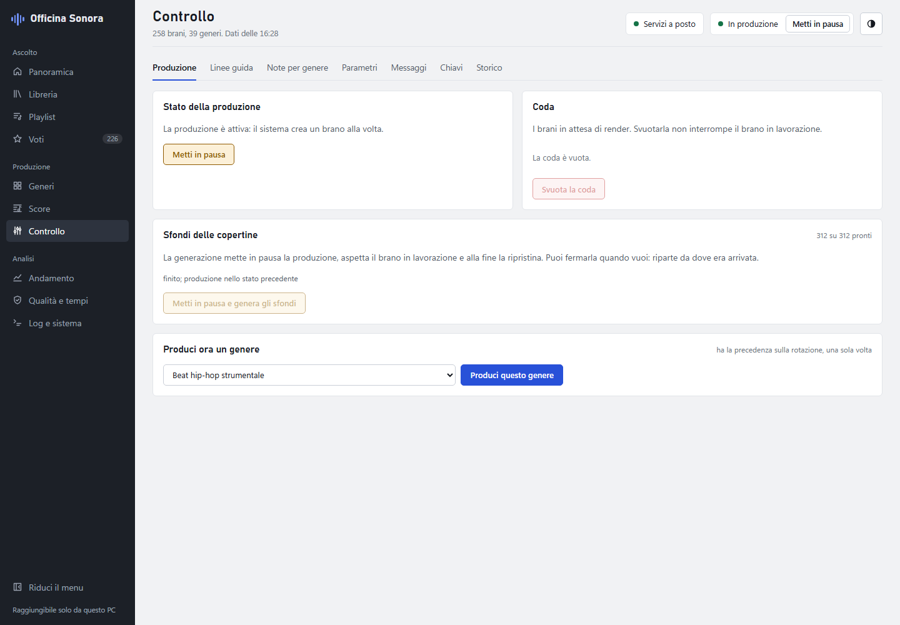

# Officina Sonora

Un sistema automatico che **crea musica di sottofondo strumentale** (e vocale senza parole) in modo continuo,
la organizza in una libreria ordinata e la pubblica su **iBroadcast** con copertine, tag e playlist.
Adatto a qualsiasi sottofondo, compresi i centri yoga.

Il sistema lavora da solo: crea un brano alla volta, lo controlla, lo carica, ti avvisa su Telegram
e impara dai voti che dai dalla dashboard, su iBroadcast e su Telegram.

---

## Indice

1. [Cosa fa, in breve](#1-cosa-fa-in-breve)
2. [Come funziona](#2-come-funziona)
3. [Cosa serve per farlo girare](#3-cosa-serve-per-farlo-girare)
4. [Avvio e arresto](#4-avvio-e-arresto)
5. [Dove guardare: dashboard, iBroadcast, Telegram](#5-dove-guardare-dashboard-ibroadcast-telegram)
6. [Come votare i brani](#6-come-votare-i-brani)
7. [Struttura delle cartelle](#7-struttura-delle-cartelle)
8. [Generi, famiglie e categorie](#8-generi-famiglie-e-categorie)
9. [Aggiungere un genere](#9-aggiungere-un-genere)
10. [Sicurezza e segreti](#10-sicurezza-e-segreti)
11. [Risoluzione dei problemi](#11-risoluzione-dei-problemi)
12. [Per chi sviluppa](#12-per-chi-sviluppa)
13. [Cosa non è in questo repository](#13-cosa-non-e-in-questo-repository)

---

## 1. Cosa fa, in breve

- Genera brani di musica in continuo, uno alla volta, con il motore **YuE2** in esecuzione sul tuo PC.
- Ogni brano riceve un titolo e una descrizione scritti da un modello linguistico locale (**LM Studio**, modello gemma).
- Controlla ogni file (durata, integrità, livello del suono, silenzi) e scarta quelli difettosi.
- Assegna un **numero progressivo unico**, che non si ripete mai.
- Salva il brano nella libreria, con i metadati (titolo, genere, bpm, tonalità, durata, ecc.) e la copertina.
- Lo carica su **iBroadcast** con tag e playlist.
- Ti manda su **Telegram** un riepilogo periodico dei brani caricati (predefinito: ogni ora, dalle 8 alle 22).
- Raccoglie i tuoi voti da dashboard, iBroadcast e Telegram, e usa i voti per decidere i generi e le ricette da produrre.
- Ogni giorno, alla prima ora della fascia dei messaggi, invia un **rapporto** con lo stato del sistema.

Non devi fare nulla di manuale: una volta avviato, continua da solo e si riprende in caso di blocchi.

---

## 2. Come funziona

```
            ogni minuto
   n8n  ─────────────────►  scelta del genere (rotazione tra i generi)
    │                              │
    │                              ▼
    │                        titolo e descrizione (gemma, LM Studio)
    │                              │
    │                              ▼
    │                        render del brano (YuE2)
    │                              │
    │                              ▼
    │                        controllo qualità (durata, file, suono)
    │                              │
    │                 ┌────────────┴────────────┐
    │                 ▼                         ▼
    │          scartato (_scartati)     metadati + copertina
    │                                           │
    │                                           ▼
    │                                  upload su iBroadcast
    │                                  (tag e playlist dopo qualche minuto)
    │                                           │
    │                                           ▼
    └──────────────────────────────────  registrazione del brano
```

Oltre al ciclo di produzione, n8n esegue in parallelo:

| Attività | Frequenza | Cosa fa |
|---|---|---|
| Voti da iBroadcast | ogni 10 minuti | legge stelle, tag e playlist che hai messo sui brani |
| Comandi Telegram | ogni minuto | risponde ai tuoi comandi e alle tue risposte |
| Avvisi Telegram | ogni minuto | ti scrive solo per errori gravi che richiedono il tuo intervento |
| Riepilogo Telegram | alla frequenza scelta, nella fascia oraria | un messaggio con i brani caricati dall'ultimo invio |
| Rapporto giornaliero | una volta al giorno, alla prima ora della fascia | riepilogo di brani, voti, errori, stato del sistema |

**Il meccanismo di apprendimento.** Ogni ricetta (genere, tipo, struttura, fascia di bpm) ha un punteggio.
I tuoi voti pesano molto più dei dati automatici. Il sistema prova anche ricette nuove, in quantità limitata,
per non restare sempre sulle stesse. Le linee guida (stile, bpm, strutture preferite) vengono riviste periodicamente
e ogni versione viene archiviata.

**Il meccanismo di rotazione dei generi.** Il genere del prossimo brano viene scelto dando più peso a quelli
con meno brani in libreria. Così i generi nuovi vengono prodotti per primi e nessun genere domina.

---

## 3. Cosa serve per farlo girare

Il sistema è pensato per **Windows 11** con questi componenti installati:

| Componente | Dove si trova | Note |
|---|---|---|
| **n8n** 2.x | `E:\n8n` (installato con npm) | è il "direttore d'orchestra" del ciclo di produzione |
| **Node.js** 24 | nel PATH di Windows | serve per il gateway e i test |
| **YuE2 Studio** | `E:\MusicAI\YuE2 Studio` | il motore che genera la musica (su GPU) |
| **LM Studio** | installato, server su `127.0.0.1:1234` | modello `google/gemma-4-e4b` |
| **Account iBroadcast** | [ibroadcast.com](https://ibroadcast.com) | dove vengono caricati i brani |
| **Bot Telegram** | creato con [@BotFather](https://t.me/BotFather) | per i messaggi e i comandi |

La libreria dei brani va in `E:\Musica di sottofondo`.

---

## 4. Avvio e arresto

I due file di avvio si trovano in `E:\n8n` (accanto alla cartella di installazione di n8n), **non** in questo repository:

- **`avvia-automazione.vbs`**: avvia tutto in background, senza finestre. Il watchdog tiene in vita gateway, n8n,
  LM Studio e il motore YuE2.
- **`ferma-automazione.vbs`**: ferma tutto. LM Studio resta acceso.

Per l'avvio e l'arresto basta fare doppio clic sul file.

**Controllo automatico.** Un'attività pianificata di Windows, chiamata `OfficinaSonoraSupervisor`, controlla ogni
5 minuti che il watchdog sia vivo e lo riavvia se si è bloccato. Se hai fermato l'automazione a mano, non la riavvia.

---

## 5. Dove guardare: dashboard, iBroadcast, Telegram

### Dashboard (stato, ascolto e voto)

**[http://127.0.0.1:5790/dashboard](http://127.0.0.1:5790/dashboard)**

Si apre nel browser **solo dal tuo PC** (l'indirizzo `127.0.0.1` non è raggiungibile da altri dispositivi).
Lo stato si aggiorna da solo ogni 5 secondi e mostra:

- quali servizi sono attivi (n8n, motore YuE2, LM Studio, modello gemma);
- il render in corso: titolo, genere, tempo trascorso, stima di avanzamento;
- la coda, i brani generati e quelli scartati, lo spazio su disco;
- il battito del watchdog e l'ultimo controllo del supervisore;
- le ultime esecuzioni di n8n e le ultime righe del log di produzione.

Dalla scheda **Voti** puoi anche ascoltare e votare i brani (vedi [come votare i brani](#6-come-votare-i-brani)).

Se la pagina non si apre, l'automazione è ferma: avviala con `avvia-automazione.vbs`.

### Andamento (il sistema sta migliorando?)

La scheda **Andamento** mostra quattro grafici nel tempo:

- **voto medio** (nel dettaglio di ogni punto c'è il numero di voti);
- **brani scartati** in percentuale;
- **secondi di render per secondo di musica buona** (conta solo i brani di cui è noto il tempo di render);
- **errori**, presi da `state\errori.jsonl` e dal file ruotato `errori.jsonl.1`: restano visibili finché il registro li conserva.

Il voto, come gli scarti, è collocato nel momento in cui il brano è stato **generato**, non in quello in cui l'hai votato.
Il passo può essere **per ora** (ultime 48 ore) o **per giorno** (ultimi 60 giorni); quello automatico è per ora
finché il brano più vecchio ha meno di 7 giorni. Il filtro per genere non si applica agli errori. I punti del voto
medio con meno di 5 voti sono disegnati vuoti. Le linee verticali tratteggiate indicano le modifiche fatte dalla
sezione Controllo (parametri, generi, linee guida, note; non i voti né i comandi di produzione) e le nuove versioni
delle linee guida.

In alto c'è il giudizio, che confronta i brani generati negli **ultimi 7 giorni** con quelli dei **7 precedenti**:

| Giudizio su | Minimo in ciascun periodo | migliora | peggiora |
|---|---|---|---|
| Voto medio | 10 brani votati | almeno +0,2 stelle | almeno -0,2 stelle |
| Brani scartati | 30 brani | almeno 5 punti percentuali in meno | almeno 5 punti percentuali in più |

Tra le due soglie il giudizio è **stabile**; sotto il minimo è **dati insufficienti**.

### iBroadcast

**[https://ibroadcast.com](https://ibroadcast.com)**: accedi con il tuo account per ascoltare i brani.
Ogni brano ha:

- **titolo**, **copertina** e un **numero di traccia** progressivo, unico per tutta la libreria;
- **album**: il nome leggibile del genere (per esempio *Vinyasa*; i brani caricati prima hanno ancora il nome della categoria);
- **tag**: ambito (`yoga` o `musica`), famiglia, categoria, energia, struttura, tipo;
- **playlist**: una per categoria, con nome `Yoga - <categoria>` o `Musica - <categoria>`.

I tag e le playlist vengono applicati alcuni minuti dopo il caricamento, perché iBroadcast deve prima elaborare il brano.

### Copertine e metadati

Ogni MP3 esce con tag ID3 completi: titolo, artista, album, genere, numero di traccia, data, bpm, tonalità,
durata, compositore, editore, descrizione e, come campi aggiuntivi, mood, energia, attività, struttura,
strumenti, variante e seed. iBroadcast usa titolo, artista, album, traccia, genere, anno e copertina;
il resto serve alla libreria locale.

La copertina è uno **sfondo del genere** generato in locale con Stable Diffusion, con titolo, genere e artista
scritti sopra. Finché un genere non ha sfondi, i suoi brani escono con una copertina provvisoria.

1. **Sfondi** (8 per genere): in dashboard, *Controllo → Produzione*, **Metti in pausa e genera gli sfondi**.
   **Ferma la generazione** interrompe; il lancio successivo riparte dai mancanti. Per rifarne uno, cancella il file
   in `assets\sfondi\<categoria>` (nella stessa cartella `_foglio.jpg` li mostra tutti).
2. **Descrizione del genere**: campo `copertina` in `config\catalogo.json` (etichetta, prompt, font).
3. **Brani già online**: con gli sfondi completi, prima una prova su 3 brani, di cui almeno uno con le stelle:
   `node tools\ripubblica.js --prova <brano1.json> <brano2.json> <brano3.json>`. Controlla il risultato
   nell'app, poi `node tools\ripubblica.js --tutti`. Ogni vecchia copia si cestina solo dopo che la nuova è
   organizzata e ha ricevuto stelle, playlist e tag; il conteggio degli ascolti su iBroadcast riparte da zero.
   La mappa in `state\ripubblica.json` permette di riprendere dopo un'interruzione.

### Telegram

Il bot ti scrive:

- **il riepilogo dei brani** caricati dall'ultimo invio (predefinito: ogni ora dalle 8 alle 22; quelli della notte arrivano alle 8);
- **una volta al giorno**: il rapporto giornaliero;
- **solo per errori gravi** che richiedono il tuo intervento (per esempio token scaduto o disco pieno).

Fuori dalla fascia oraria non arriva nessun messaggio automatico (gli avvisi gravi attendono la riapertura); le risposte ai tuoi comandi arrivano sempre. Frequenza, orari e dati di ogni messaggio si regolano in **Controllo → Messaggi** nella dashboard e valgono dal giro successivo, entro un minuto.

Comandi disponibili:

| Comando | Cosa fa |
|---|---|
| `/menu` | menu con i pulsanti, compreso **Vota un brano** |
| `/stato` | a che punto siamo: brani, coda, errori |
| `/annulla` | scarta le modifiche in attesa |
| `/aiuto` | elenco dei comandi |

Puoi anche scrivere in italiano cosa vuoi cambiare, per esempio: *"Vinyasa più ritmato, bpm tra 100 e 120"*.

---

### Flusso di produzione (n8n)


Il diagramma è generato automaticamente dal workflow (`tools\diagramma.mjs`), quindi resta allineato alla versione pubblicata.
Ogni colore indica una fase:

- **Avvio**: il trigger parte ogni minuto e lancia in parallelo i controlli periodici.
- **Controllo**: il lock della pipeline evita esecuzioni sovrapposte; poi si decide se c'è un render in corso.
- **Composizione**: si sceglie il genere (rotazione e pesi), si scrive il titolo e si compone lo stile.
- **Render e stato**: il brano viene inviato al motore YuE2; a fine render lo stato viene salvato.
- **Audio e caricamento**: download, metadati, controllo qualità, upload su iBroadcast, tag e playlist.
- **Apprendimento**: revisione periodica delle linee guida in base ai voti.
- **Telegram** e **Rapporto e voti**: comandi, avvisi, rapporto giornaliero e lettura dei voti, in parallelo al ciclo principale.

### Schermate della dashboard

| Panoramica | Controllo: produzione |
|---|---|
|  |  |
|  |  |

Tutte le schermate sono in [`docs/screenshots`](docs/screenshots). Si rigenerano con `tools\screenshot.ps1`.

### Controllo della produzione

La sezione **Controllo** della dashboard permette di intervenire senza toccare i file:

- **Produzione**: metti in pausa o riprendi; svuota la coda; produci subito un genere scelto.
- **Parametri**: durata, esplorazione, peso dei tuoi voti, soglie del controllo qualità. Ogni valore ha limiti precisi.
- **Generi**: attiva o sospendi un genere, e regola il suo peso di frequenza (0 = mai, 5 = cinque volte più spesso).
- **Linee guida**: stile da aggiungere o evitare, note, fasce di bpm per genere.
- **Note per genere**: scrivi in italiano cosa vuoi sentire (per esempio *fai più assoli* o *usa il flauto di pan*). Il sistema la traduce in inglese e la aggiunge allo stile dei brani di quel genere.
- **Messaggi**: frequenza del riepilogo Telegram, ora di inizio e di stop, e quali dati includere in ogni messaggio.
- **Storico**: ogni modifica è registrata con il valore precedente.

Le modifiche valgono dal prossimo brano.

## 6. Come votare i brani

Puoi votare in tre modi, con voti da 1 a 5: dalla dashboard, da Telegram e dall'app iBroadcast.
Il voto è salvato nel file `.json` del brano, che è l'unica fonte dei voti; dashboard e Telegram identificano il
brano con il numero di traccia.

### Dalla dashboard

Apri la scheda **Voti**. In alto trovi **Da votare**: un brano alla volta, con il lettore audio.

- La coda propone prima i generi con meno voti e, a parità, i brani più recenti. Non contiene i brani scartati né
  quelli generati da meno di 15 minuti. Puoi filtrarla per genere.
- Vota con le stelle o con i tasti **1-5** (non mentre stai scrivendo la nota). Dopo il voto la pagina passa al
  brano successivo e prova ad avviarlo. **Salta** passa oltre senza votare.
- La **nota** è facoltativa (massimo 300 caratteri, senza `<` o `>`) e viene salvata insieme al voto: scrivila
  prima di votare. La revisione delle linee guida ne tiene conto.
- **Votati ora** elenca gli ultimi 20 brani votati: un clic riapre il brano per correggere voto o nota.

I voti dati dalla dashboard compaiono nello **Storico** della sezione Controllo, con il valore precedente.

### Da Telegram

Scrivi `/menu` e scegli **Vota un brano**: il bot propone gli 8 brani più recenti. Scegli il brano e il voto;
il messaggio successivo diventa la nota (`/annulla` se non vuoi aggiungerne). Anche questi voti finiscono nello Storico.

### Da iBroadcast

Usa le stesse regole per tutti i generi:

- **Stelle** (da 1 a 5) sul brano.
- **Tag** `preferito`, `scarta` oppure `voto-N` (N da 1 a 5).
- **Playlist** con lo stesso nome dei tag.
- **Tag** `piu-veloce` o `piu-lento`: spostano il bpm del genere di 6, entro un limite di 15 dalla fascia base.
- **Cestino**: un brano nel cestino vale come voto 1, se non c'è un segnale migliore.

Se un brano ha più segnali, le stelle prevalgono su tag e playlist, e questi sul cestino.

I tag e le playlist creati dal sistema (`yoga`, `musica`, `famiglia-*`, `categoria-*`, ecc.) **non contano** come voti.

### Regola "vince l'ultimo"

Vale l'ultimo voto dato, ovunque tu l'abbia dato. I voti di iBroadcast vengono letti ogni 10 minuti, quindi il
sistema vede una modifica fatta nell'app **fino a 10 minuti dopo** (di più se in quel momento la produzione è occupata),
e per lui "ultimo" è quel momento.

- Un segnale di iBroadcast sostituisce il voto solo quando **cambia**: se voti dalla dashboard o da Telegram, le
  stelle già presenti nell'app non sovrascrivono il nuovo voto.
- Se togli il segnale in iBroadcast, il voto salvato resta.
- I voti dati dalla dashboard o da Telegram **non** vengono scritti su iBroadcast: nell'app le stelle restano quelle di prima.

La revisione delle linee guida tiene conto sia dei voti nuovi sia di quelli corretti.

---

## 7. Struttura delle cartelle

### Questo repository (`E:\n8n\officina-sonora`)

| Cartella / file | Contenuto |
|---|---|
| `src\blocks\` | i blocchi del ciclo di produzione, uno per ogni nodo di n8n |
| `src\lib.js`, `src\lib-apprendimento.js`, `src\lib-ibroadcast.js` | funzioni condivise: scelta delle ricette, file audio, upload, tag |
| `src\cover.js` | copertina provvisoria e frame della copertina |
| `gateway\copertina.js`, `gateway\sfondi.js` | composizione delle copertine; generazione degli sfondi dalla dashboard |
| `assets\sfondi\` | sfondi per genere (non nel repository) |
| `tools\genera-sfondi.js`, `tools\ripubblica.js` | sfondi delle copertine; aggiornamento dei brani già online |
| `config\catalogo.json` | l'elenco dei generi: stile, strumenti, bpm, varianti, colori |
| `config\guidance.json` | le linee guida correnti (stile, bpm, strutture preferite) |
| `config\history\` | archivio delle versioni precedenti delle linee guida |
| `gateway\` | il servizio locale che tiene i token e parla con iBroadcast e Telegram |
| `gateway\dashboard.html`, `gateway\stato.js` | la dashboard di stato |
| `gateway\voti.js`, `gateway\andamento.js` | ascolto e voto dei brani; andamento nel tempo |
| `tools\` | script di manutenzione usati nel tempo (correzioni, migrazioni, prove) |
| `tools\test\` | test automatici |
| `watchdog.ps1`, `supervisore.ps1`, `supervisore.vbs`, `stop.ps1` | sorveglianza e arresto |
| `build-workflow.mjs` | genera il workflow di n8n dai blocchi in `src\` |
| `officina-sonora-workflow.json` | il workflow generato, pronto per essere importato in n8n |

### Fuori dal repository

| Cartella | Contenuto |
|---|---|
| `E:\Musica di sottofondo\` | la **libreria** dei brani (non va su Git: sono file audio) |
| `E:\Musica di sottofondo\_scartati\` | brani scartati dal controllo qualità |
| `E:\n8n\officina-sonora\state\` | stato in esecuzione: coda, log, contatori, battito (non va su Git) |
| `E:\n8n\officina-sonora\secrets\` | token cifrati con DPAPI (non va su Git) |

Il vecchio file `feedback.csv` per i voti manuali **non è più usato**: scriverci non ha effetto.

**Organizzazione della libreria:**
```
E:\Musica di sottofondo\
  Yoga\<famiglia>\<categoria>\<tipo>\        brano.mp3 + brano.json
  Sottofondo\<famiglia>\<categoria>\<tipo>\  brano.mp3 + brano.json
```

---

## 8. Generi, famiglie e categorie

Ogni brano appartiene a tre livelli:

1. **Ambito** (il target): `Yoga` per la pratica yoga, `Sottofondo` per tutto il resto.
2. **Famiglia** (il carattere): `meditativo`, `ritmico`, `rock`, `elettronico`, `orchestrale`, `world`, `jazz`.
3. **Categoria** (il genere preciso): per esempio *Vinyasa-dinamico*, *Synthwave* o *Gamelan ambient*.

Il catalogo oggi contiene **39 generi**: quelli per lo yoga (meditazione, respiro, asana, rilassamento) e
quelli per il sottofondo (rock e metal strumentali, elettronica, jazz, world, canti senza parole, ecc.).

Per **i generi vocali senza parole** (per esempio *Vocalise coro* o *Canto armonico overtone*) la voce è usata
come strumento, senza testo cantato, e il sistema non applica il filtro che elimina la voce.

---

## 9. Aggiungere un genere

1. Apri `config\catalogo.json` e aggiungi una voce con: `name`, `ambito`, `famiglia`, `energia` (da 1 a 5),
   `bpm` (per esempio `[90, 110]`), `attivita`, `strutture`, `genere`, `stile`, `strumenti`, `vietati`,
   `influenze`, `enfasi`, `melodia`, `accordi`, `ritmica`, `tonalita`, `varianti`, `colori` (tre colori esadecimali).
   Per un genere vocale senza parole aggiungi anche `"vocale_senza_parole": true`.
2. Ricostruisci il workflow e pubblicalo (vedi [per chi sviluppa](#12-per-chi-sviluppa)).

Il nuovo genere riceve subito i suoi tag, la sua playlist, i suoi voti e la sua copertina: non serve altro.

---

## 10. Sicurezza e segreti

- I **token** (Telegram e iBroadcast) sono salvati cifrati in `secrets\` con **DPAPI**: possono essere letti solo
  dal tuo utente di Windows, su questo PC. Non sono nel repository.
- Solo il **gateway** conosce i token. I blocchi di n8n chiamano il gateway su `127.0.0.1` e non li vedono mai.
- Il gateway accetta solo richieste dal tuo PC e solo le operazioni previste. Rifiuta le richieste rivolte a un
  nome diverso da `127.0.0.1:5790` o `localhost:5790` e le richieste di scrittura inviate da pagine di altri siti.
- La **dashboard** non mostra token. Modifica solo ciò che prevedono la sezione Controllo e il voto dei brani;
  l'audio si richiede con il numero di traccia, mai con un percorso.
- Il file `config\telegram.json` (con il tuo chat ID) **non è nel repository**: va ricreato a mano (vedi sotto).

**Se rigeneri i token** (per esempio dopo una password cambiata): esegui `ibroadcast-login.ps1` e segui le istruzioni,
oppure aggiorna il token Telegram in `secrets\telegram.dpapi`.

**Ricreare `config\telegram.json`:**
```json
{
  "chat_id": 000000000
}
```
Sostituisci il numero con il tuo chat ID Telegram.

---

## 11. Risoluzione dei problemi

| Sintomo | Cosa fare |
|---|---|
| La dashboard non si apre | l'automazione è ferma: esegui `avvia-automazione.vbs` |
| Nessun brano da molto tempo | apri la dashboard: controlla quali servizi sono spenti |
| Il motore YuE2 non risponde | il watchdog lo riavvia da solo; verifica `state\watchdog.log` |
| Il Telegram dice "token non valido" | rigenera il token e aggiornalo (vedi sezione sicurezza) |
| Un brano non compare su iBroadcast | cerca in `state\errori.jsonl` e in `state\tick.log` |
| Si vuole fermare tutto | esegui `ferma-automazione.vbs` (il supervisore non riavvia nulla) |

**Dove sono i log:**
- `state\tick.log`: cosa fa la produzione, passo per passo.
- `state\watchdog.log`: avvii e riavvii dei servizi.
- `state\supervisore.log`: interventi del supervisore.
- `state\errori.jsonl`: errori raggruppati per tipo.

---

## 12. Per chi sviluppa

**Requisiti:** Node.js 24, Git.

**Test automatici** (dalla cartella del progetto):
```powershell
node --test tools/test/*.test.js
```
Il test `rotazione` si basa sul caso e ogni tanto può fallire: in quel caso ripetilo.

**Pulizia una tantum dei voti** (nel passaggio ai voti nel `.json`; `--applica` solo a produzione ferma):
```powershell
node tools/pulisci-voti.js            # prova a vuoto: non modifica nulla
node tools/pulisci-voti.js --applica
```
Rimuove i voti senza fonte (copiati tra brani con lo stesso nome di file), segna quelli arrivati da iBroadcast e
rinomina `feedback.csv` in `feedback.csv.vecchio`. Prima di scrivere salva una copia in `state\backup`.

**Modificare un blocco e pubblicarlo in n8n:**
```powershell
node build-workflow.mjs
```
Poi importa `officina-sonora-workflow.json` in n8n e pubblicalo con il comando di n8n `publish:workflow --id=yogaMusicFactory01`.
Prima di ripubblicare, verifica che non ci sia un render in corso (`state\pipeline.lock` assente), perché il riavvio
di n8n interrompe la pipeline. Se sono cambiati anche i file in `gateway\`, riavvia il gateway insieme al workflow:
i blocchi e il gateway devono essere della stessa versione.

**Storico:** il repository contiene la storia completa delle modifiche. Ogni versione importante ha un messaggio di commit.

---

## 13. Cosa non è in questo repository

Per tenere il repository leggero e sicuro, non sono inclusi:

- l'installazione di **n8n** e i file di avvio `avvia-automazione.vbs` e `ferma-automazione.vbs` (in `E:\n8n`);
- il **motore YuE2** e i suoi modelli;
- i **modelli** di LM Studio;
- la **libreria audio** (`E:\Musica di sottofondo`);
- i **segreti** e lo **stato** di esecuzione.

Chi volesse ricostruire tutto da zero deve reinstallare questi componenti e ricreare `config\telegram.json`
e i token.
