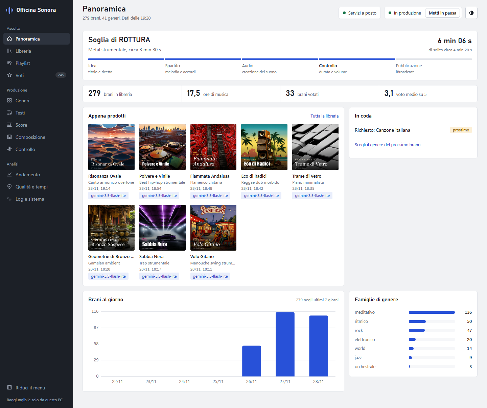
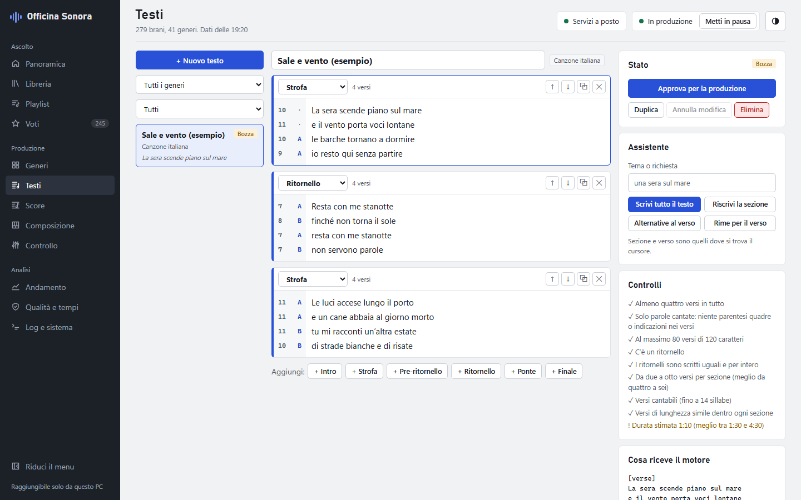
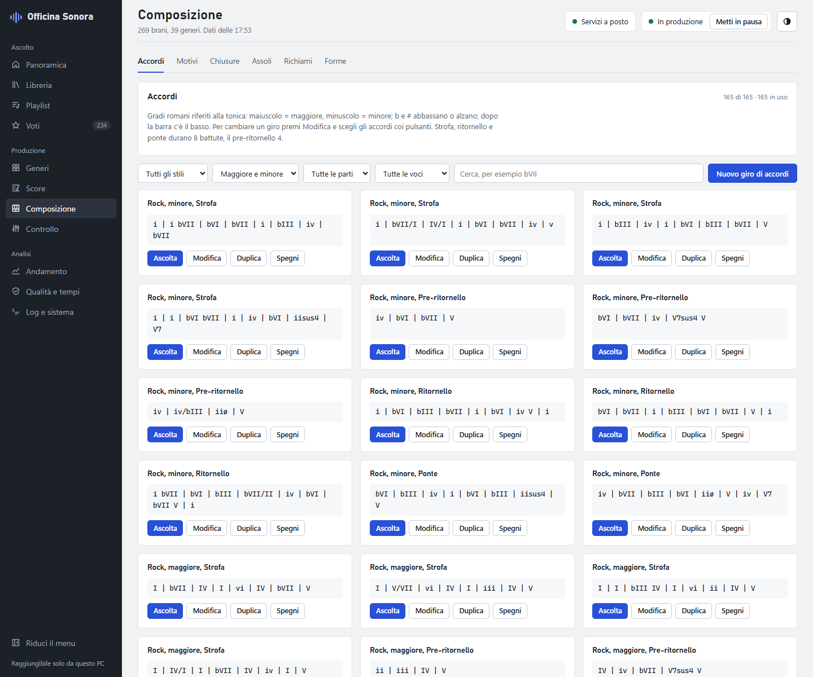
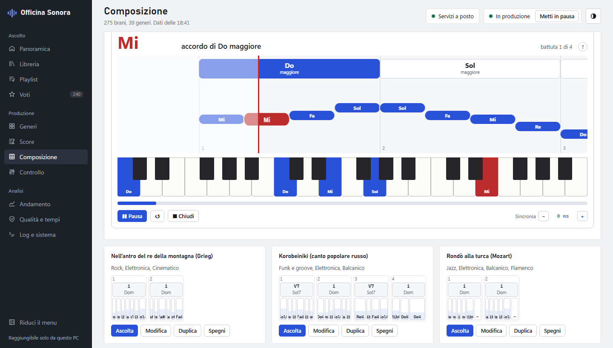
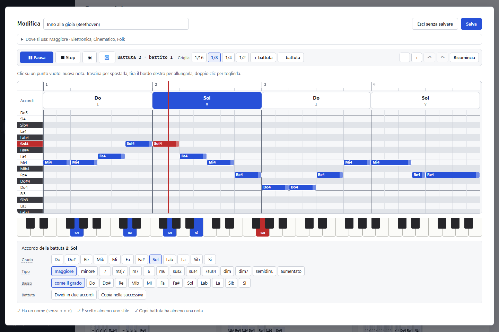
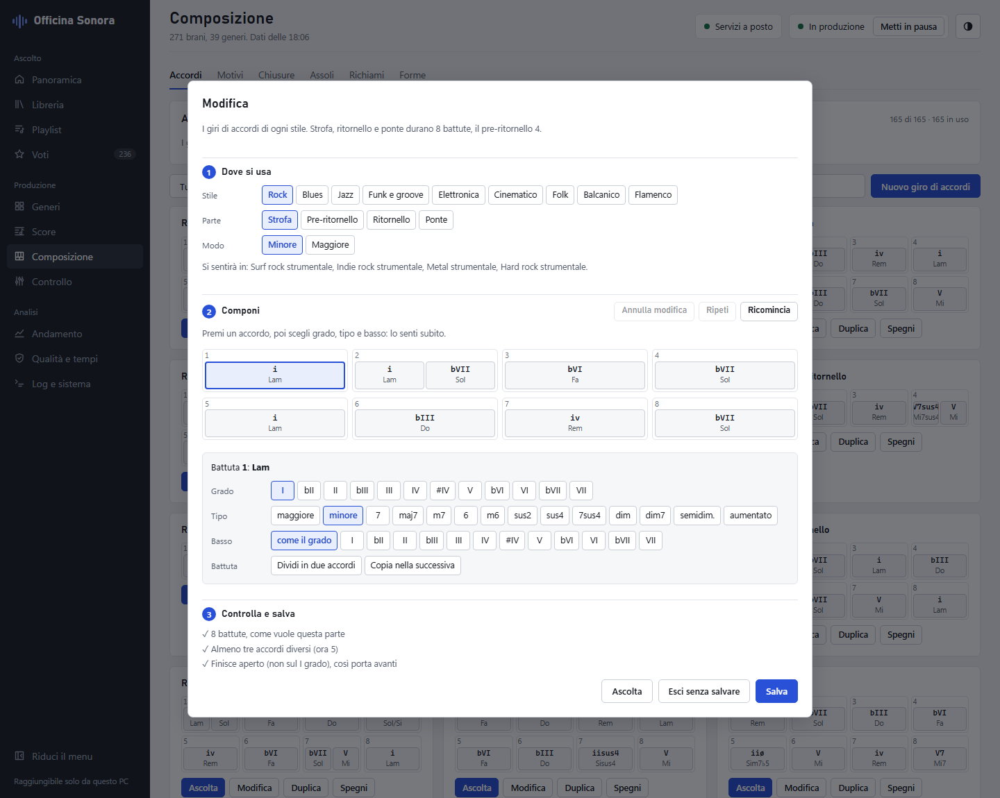
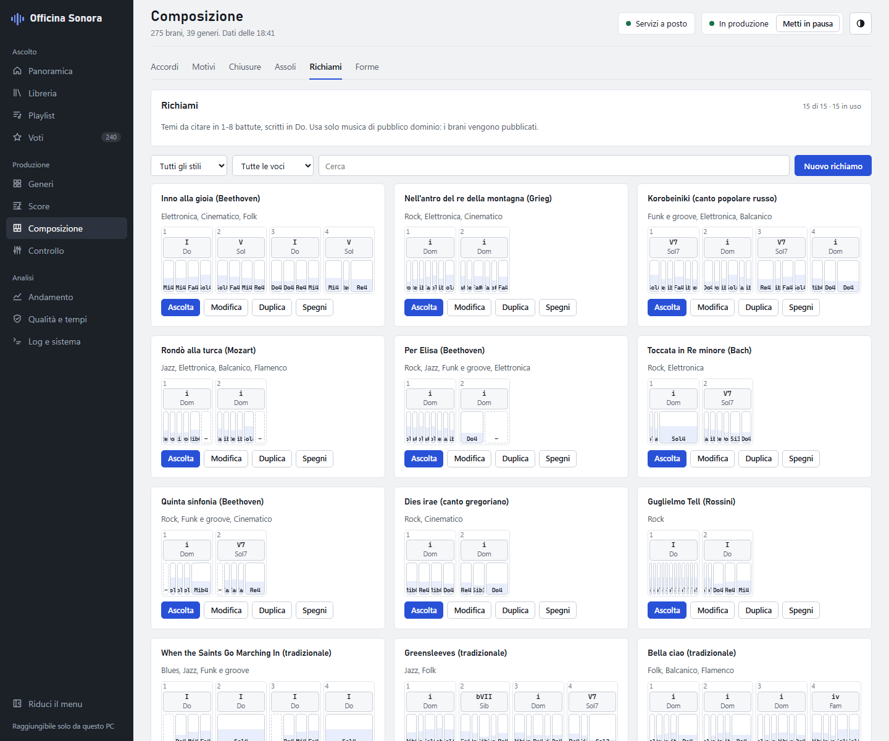
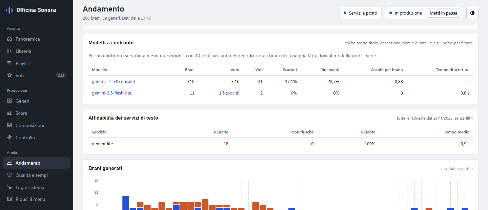
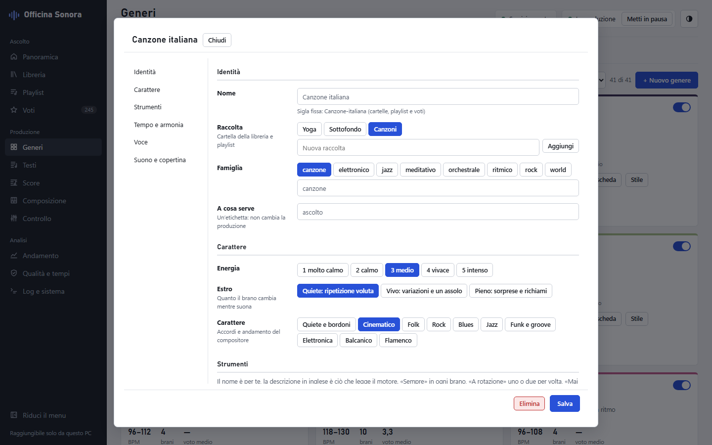

# Officina Sonora

**Una piccola fabbrica di musica di sottofondo che lavora da sola sul tuo computer.**

Inventa brani di qualsiasi genere (strumentali, con vocalizzi o **cantati con parole**), controlla che siano riusciti, li mette
in ordine e li carica sul tuo spazio musicale in rete (**iBroadcast**) con copertina e playlist. Tu ascolti, dai un
voto e, se vuoi, chiedi cambiamenti: il sistema ne tiene conto per i brani successivi.



## Le parole da conoscere

| Parola | Significato |
|---|---|
| **Brano** | un pezzo musicale prodotto dal sistema |
| **Genere** | il tipo di musica (di serie 41; ne crei altri dalla dashboard) |
| **Dashboard** | la pagina web da cui controlli tutto |
| **Render** | il momento in cui il computer crea l'audio; dura alcuni minuti |
| **YuE2** | il programma che **crea la musica** |
| **Servizi di testo** | i modelli in rete (Gemini, Groq, OpenRouter) che **scrivono** titoli, descrizioni e analisi |
| **gemma** | il modello di testo sul tuo computer (dentro *LM Studio*), usato quando i servizi in rete non rispondono |
| **n8n** | il «direttore d'orchestra» che fa eseguire i passi nell'ordine giusto |
| **Gateway** | il piccolo servizio che fa funzionare la dashboard |
| **Watchdog / supervisore** | i guardiani che riavviano i programmi se si fermano |
| **Prompt** o **stile** | la descrizione in inglese del brano data a YuE2 |
| **Score** | lo spartito che guida la creazione di un brano |
| **BPM** | battiti al minuto: la velocità della musica |

## Indice

1. [Guida rapida](#1-guida-rapida)
2. [Come funziona](#2-come-funziona)
3. [I blocchi, uno per uno](#3-i-blocchi-uno-per-uno)
4. [Come nasce la musica](#4-come-nasce-la-musica)
5. [La dashboard](#5-la-dashboard)
6. [Telegram](#6-telegram)
7. [Votare i brani](#7-votare-i-brani)
8. [iBroadcast, copertine e metadati](#8-ibroadcast-copertine-e-metadati)
9. [Generi e libreria](#9-generi-e-libreria)
10. [Requisiti e installazione](#10-requisiti-e-installazione)
11. [Sicurezza](#11-sicurezza)
12. [Risoluzione dei problemi](#12-risoluzione-dei-problemi)
13. [Per chi sviluppa](#13-per-chi-sviluppa)
14. [Miglioramenti futuri](#14-miglioramenti-futuri)

---

## 1. Guida rapida

### Il primo giorno, in quattro passi

1. **Accendi**: doppio clic su `E:\n8n\avvia-automazione.vbs`.
2. **Apri la dashboard**: [http://127.0.0.1:5790/dashboard](http://127.0.0.1:5790/dashboard).
3. **Controlla in alto a destra**: *Servizi a posto* e *In produzione*.
4. **Aspetta il primo brano** (circa 5-10 minuti), premi sulla sua copertina per ascoltarlo e dagli un voto.

Da qui in poi il sistema lavora da solo. Ogni 5 minuti un controllo automatico verifica che sia vivo e, se serve, lo
riavvia; se l'hai fermato tu, non lo riavvia. **Vota con regolarità**: senza voti non può imparare i tuoi gusti.

### Cosa voglio fare?

| Voglio... | Dove andare |
|---|---|
| **Avviare** la produzione | doppio clic su `E:\n8n\avvia-automazione.vbs` |
| **Spegnere** tutto | doppio clic su `E:\n8n\ferma-automazione.vbs`; resta spento finché non riavvii tu (LM Studio resta acceso) |
| Usare i **modelli di testo in rete**, gratis | [Controllo → Chiavi](#chiavi): crea le chiavi dai link e incollale |
| Fare una **pausa** senza spegnere | *Metti in pausa* in alto a destra, in ogni pagina; su Telegram `/pausa` e `/riprendi` |
| **Vedere se funziona** | [Panoramica](#panoramica): la riga delle fasi e gli eventuali avvisi |
| **Ritrovare e riascoltare** un brano | [Libreria](#libreria) (tasto `/` per cercare) |
| **Ascoltare** di seguito, in ordine o a caso | *Riproduci* o *Casuale* in [Libreria](#libreria) e [Playlist](#playlist); vedi [Il lettore](#il-lettore) |
| **Preparare la musica per una lezione** | una [playlist](#playlist), con [dissolvenza e timer di spegnimento](#timer-dissolvenza-e-scorciatoie) |
| **Dare un voto** | stelle nel [lettore](#il-lettore), pagina [Voti](#voti), `/menu` su Telegram o stelle in iBroadcast |
| **Non superare i 5 GB** di iBroadcast | è automatico: vedi [rotazione](#spazio-la-rotazione-dei-brani); dai voto 5 ai brani da conservare |
| **Vedere, ascoltare e modificare uno score** | pagina [Score](#score) |
| **Creare un genere** nuovo o cambiarne la scheda | [Creare o modificare un genere](#creare-o-modificare-un-genere) |
| Scrivere o approvare le **parole** di un brano cantato | [Testi](#testi) |
| **Vedere, cambiare o aggiungere** accordi, motivi, assoli, richiami e forme | [Composizione](#composizione) |
| **Decidere come nascono gli score** nuovi | [Score → Come nascono](#come-nascono) |
| Brani **più ricchi di variazioni** o, al contrario, più calmi | [Score → Come nascono](#come-nascono), voce *Estro* (vedi [Quiete o estro](#quiete-o-estro)) |
| **Scaricare** un brano o vedere come è stato fatto | clic sul titolo: [scheda del brano](#la-scheda-del-brano) |
| Avere **subito** un certo genere | [Generi](#generi): *Produci ora* |
| **Sospendere** un genere o farlo uscire di più | [Generi](#generi): interruttore sulla scheda, peso in *Attivazione e frequenza* |
| **Chiedere un cambiamento** a parole | [Note per genere](#note-per-genere), in italiano |
| **Scegliere i termini** dello stile | [Linee guida](#linee-guida) |
| Capire **se migliora** | [Andamento](#andamento) |
| Capire **quale modello di testo rende di più** | [Andamento → Modelli a confronto](#modelli-a-confronto) |
| Capire **perché un brano è stato scartato** | [Qualità e tempi](#qualità-e-tempi) e [Log e sistema](#log-e-sistema) |

---

## 2. Come funziona

**In parole semplici**, ogni brano passa da questi passi, uno alla volta:

1. il sistema **sceglie** genere, strumenti e forma, dando precedenza a ciò che hai votato bene;
2. un **servizio di testo** in rete (o, se non risponde, **gemma**) inventa titolo e descrizione;
3. si prepara lo **spartito** (calmo e ripetuto o [ricco di variazioni](#quiete-o-estro), secondo l’estro del genere; per i brani con voci lo scrive il motore) e **YuE2** crea l'audio (la parte più lunga);
4. il volume viene reso uniforme e il brano **controllato**: se non va bene viene rifatto;
5. se è buono, viene salvato, **caricato** su iBroadcast e compare nella dashboard;
6. i tuoi **voti** guidano le scelte successive.

Lo schema seguente è per chi vuole i dettagli.

```
 watchdog (ogni minuto): tiene vivi gateway, n8n, LM Studio, motore YuE2
                         e scarica gemma dalla GPU durante i render
 testi: gateway ──► Gemini ► Groq ► OpenRouter ► gemma in locale

 n8n (ogni minuto)
   1 Leggi stato ── render in corso? ──no──► 5a ricetta ► 5b titolo ► 5c stile ► 5d ripiego ► 6 invio a YuE2
                          │
                          sì
                          ▼
   2 Controlla render ── finito? ──no──► 7 Scrivi stato
                          │
                          sì
                          ▼
   3a audio e score ► 3b scheda ► 3c qualità ► 3d1-3d4 iBroadcast ► 4 apprendimento ► 7 stato

 in parallelo: 8a comandi Telegram · 8b avvisi · 9 rapporto · 10 voti iBroadcast · 11 riepilogo
```


Il diagramma è generato dal workflow con `tools\diagramma.mjs`.

Si produce **un brano alla volta**. Un file di lock (`state\pipeline.lock`) impedisce esecuzioni sovrapposte
e scade dopo 15 minuti se qualcosa si blocca. Lo stato (coda, render in corso, contatori) è in `state\state.json`.

---

## 3. I blocchi, uno per uno

Ogni blocco è un file in `src\blocks\` e un nodo *Code* in n8n. `build-workflow.mjs` incolla in testa a ciascuno
le librerie condivise (`src\lib.js`, `lib-apprendimento.js`, `lib-messaggi.js`).

### Orchestrazione

| Blocco | Cosa fa |
|---|---|
| **1 Leggi stato** | Carica lo stato, prende il lock, esegue il comando "svuota coda" della dashboard e dice se c'è un render in corso. |
| **2 Controlla render** | Chiede al motore lo stato del job. Quando è pronto lo **score**, lo rende strumentale, ne ricava durata e lyrics e avvia il render dell'audio; se lo score non va bene prova a **recuperarlo** (troncato o troppo lungo) e altrimenti ne chiede un altro (3 in tutto, [regolabili](#come-nascono)). Un render fallito, sparito o fermo da oltre 4 ore torna in coda; dopo 3 tentativi lo abbandona. |
| **7 Scrivi stato** | Salva lo stato in modo atomico e rilascia il lock. Ci passano tutti i rami. Se lo stato risulta illeggibile ne viene tenuta una copia (`.corrotto`). |

### Testi

Le parole dei brani **cantati**. Compare un genere per ogni scheda con voce *Testo cantato* (di serie: *Canzone
italiana* e *Pop inglese*, sospesi finché non li accendi in [Generi](#generi)).



| Zona | Cosa fa |
|---|---|
| **Elenco** (sinistra) | tutti i testi, con filtro per genere e stato: *Bozza*, *Approvato*, *Usato*. *+ Nuovo testo*: scegli il genere e scrivi, oppure incolla un testo già pronto (riconosce `[Strofa]`, `[Ritornello]`…) |
| **Sezioni** (centro) | un blocco per strofa, ritornello, ponte…: cambia tipo, sposta, duplica, elimina. Un verso per riga; a fianco il numero di **sillabe** e la lettera della **rima** (stime). Salva da sola |
| **Stato** | *Approva per la produzione*; ogni modifica riporta il testo in bozza. *Duplica*, *Annulla modifica*, *Elimina* |
| **Assistente** | scrive tutto il testo da un tema, riscrive la sezione del cursore, propone alternative o rime per il verso; nulla va in produzione senza i passi sopra |
| **Controlli** | in rosso ciò che impedisce l'approvazione (meno di quattro versi, indicazioni tra parentesi, testo troppo lungo), in giallo i consigli |
| **Cosa riceve il motore** | il testo esattamente come va a YuE2 |

Per ogni genere cantato scegli **chi scrive le parole** (pagina Generi, parte *Voce*):

| Scelta | Cosa succede |
|---|---|
| **Automatico** | se non c'è un testo approvato, la produzione lo scrive e lo usa da sola |
| **Automatico con approvazione** (di serie) | la produzione prepara una bozza per volta; il brano si produce solo dopo che l'hai approvata |
| **Solo parole mie** | si producono solo i testi che hai scritto e approvato; l'IA aiuta se la chiami |

Un testo vale per **un brano** (per rifarlo: *Duplica*). Un genere senza testi pronti viene saltato: la produzione
continua con gli altri (un *Produci ora* resta in attesa e parte appena approvi il testo). I testi stanno in `state\parole.json`, **fuori da Git**. Lo score dei brani cantati lo scrive
il motore; viene usata una sola LoRA, quella del genere (di serie *Canzone Italiana* per l'italiano). Le parole
finiscono anche nell'MP3 (campo testo ID3). YuE2 non dichiara quali lingue sa cantare: **ascolta i primi brani**,
soprattutto in italiano, prima di produrne molti.

### Composizione

Il materiale con cui il compositore scrive i brani dei [generi creativi](#quiete-o-estro): lo consulti, lo ascolti,
lo modifichi e ne crei di nuovo **senza scrivere codici**. Le modifiche valgono **dal brano successivo**.



| Scheda | Cosa contiene | Cosa scegli coi pulsanti |
|---|---|---|
| **Accordi** | 165 giri per stile, modo e parte del brano (8 battute, 4 il pre-ritornello) | grado, tipo, basso, due accordi in una battuta |
| **Motivi** | 30 ritmi di due battute per andamento | nota o pausa, durata, appoggiatura, anticipo |
| **Chiusure** | 5 ritmi con cui si chiude una frase | come i motivi |
| **Assoli** | 12 frasi di una battuta | durata e movimento di ogni nota: arrivo, passo, volta, arpeggio, salto, cromatica, ripetuta |
| **Richiami** | 15 temi di pubblico dominio, in Do | note, ottave, durate e accordi; fino a 8 battute |
| **Forme** | 4 successioni di sezioni | tipo e lunghezza di ogni sezione, ordine, se è sempre presente o *extra* |

Ogni voce dell'elenco ha una **mini timeline**: la riconosci a colpo d'occhio.

| Pulsante | Cosa fa |
|---|---|
| **Ascolta** | apre la [timeline di riproduzione](#la-timeline-di-riproduzione) e suona la voce: per motivi e assoli su un giro di prova, per le forme un brano intero. Serve a giudicare note e ritmo, **non** il suono finale |
| **Modifica** | apre il [banco di lavoro](#il-banco-di-lavoro) |
| **Duplica** | parte da una copia per crearne una tua |
| **Spegni / Accendi** | il compositore non la usa più, senza cancellarla. Se un gruppo resta tutto spento, usa le voci di serie |
| **Ripristina** | toglie la tua modifica a una voce di serie |
| **Elimina** | solo per le voci create da te |

#### La timeline di riproduzione

Pensata per chi non legge la musica: è l'ascolto **dall'elenco**. Prende il posto della voce, così si guarda una
cosa sola; *Chiudi* fa tornare tutto. Mentre modifichi si ascolta invece dal [banco di lavoro](#il-banco-di-lavoro).



| Parte | Cosa ti dice |
|---|---|
| **Nota** in grande e accordo per intero | per esempio *Mi* · *accordo di Do maggiore* (*pausa* se la melodia tace) |
| **Nastro** | scorre senza scatti da destra a sinistra sotto la **riga rossa ferma**: in alto gli accordi, sotto le note. Più in alto = più acuta, più larga = più lunga |
| **Tastiera** | in **rosso** la nota della melodia, in **blu** i tasti dell'accordo, con il nome sul tasto |
| Barra sottile | tutto l'ascolto: premi un punto (o usa le frecce) per saltare |
| *Pausa* · ↺ · *Chiudi* | ferma e riprende, ricomincia, chiude |
| **Sincronia** | la riga segue ciò che la scheda audio sta facendo uscire (vale anche per il banco di lavoro); se con le tue cuffie (tipico quelle senza fili) arriva prima o dopo il suono, correggila di 50 ms alla volta: il valore resta memorizzato nel browser |

Le spiegazioni stanno nei **suggerimenti**, che compaiono solo passando sopra: il **?** accanto alla nota, la
tastiera, la barra, *Sincronia* e, nell'editor, le etichette sottolineate a puntini (*Grado*, *Durata*,
*Movimento*…).

#### Il banco di lavoro

*Modifica*, *Duplica* e *Nuovo* aprono un banco a tutto schermo, come nei programmi di musica.



| Zona | Cosa fa |
|---|---|
| **▶ Play / Pausa**, **■ Stop** | ascolta **dal cursore**; Pausa si ferma dove sei, Stop torna al punto di partenza. ⏮ porta all'inizio, 🔁 ripete in continuo |
| **Righello** | clic o trascinamento per mettere il **cursore** dove vuoi, anche durante l'ascolto |
| **Timeline** | scorre liberamente (barre, rotella, dito); durante l'ascolto segue la riga, ma non se la stai scorrendo tu. − + o `Ctrl`+rotella per ingrandire |
| **Tastiera** | si accende con i tasti che suonano |
| **Proprietà** (sotto) | i pulsanti dell'elemento scelto: tutto si può cambiare anche da qui |
| *Dove si usa* | stile, parte, modo, andamento (si apre con un clic); il nome sta in alto |
| Controlli (in fondo) | ✓ a posto, ✗ blocca *Salva*, ○ consiglio |

| Voce | Come si modifica sulla timeline |
|---|---|
| **Note** (richiami, motivi, chiusure) | clic su un punto vuoto = nuova nota (trascinando la allunghi); trascina per spostarla nel tempo e, nei richiami, in altezza; tira il bordo destro per allungarla; doppio clic per toglierla. La **griglia** (1/16, 1/8, 1/4, 1/2) decide gli agganci |
| **Assoli** | come le note; ogni riga è un movimento (arrivo, passo, arpeggio…): trascina su un'altra riga per cambiarlo |
| **Accordi** | premi un accordo e scegli nota di base, tipo e basso; *Dividi* ne mette due in una battuta, *Copia nella successiva* lo ripete |
| **Forme** | trascina le sezioni per riordinarle, tira il bordo per la lunghezza, *+ Strofa*, *+ Ritornello*… per aggiungerne; il finale resta in coda |



| Tasto | Effetto |
|---|---|
| **Spazio** · **Inizio** | Play o Pausa · cursore all'inizio |
| **← → ↑ ↓** | sposta la nota scelta (senza nota scelta, le frecce muovono il cursore) |
| **Maiusc + ← →** | accorcia o allunga la nota |
| **Canc** | elimina la nota |
| `Ctrl+Z` · `Ctrl+Y` | annulla · ripeti la modifica |

Le note di una battuta sono a **voce sola**: posandone una sopra un'altra, quella sotto si accorcia o sparisce; gli
spazi vuoti sono pause. `Esc` non chiude se ci sono modifiche non salvate.



I filtri (stile, modo, parte, andamento, *solo le tue*) e la ricerca restringono l'elenco. Le tue modifiche stanno
in `config\composizione.json` (le voci di serie restano nel codice) e sono registrate nello [Storico](#storico). Il
compositore dei generi di quiete e gli strumenti dei generi non passano da questa pagina.

---

### Andamento

Risponde alla domanda **«sta migliorando?»**.


| Parte (dall'alto) | Cosa mostra |
|---|---|
| **Filtri** | scegli il periodo (da 24 ore a tutto) e, se vuoi, raccolta, famiglia, genere, tipo, struttura o modello dei testi; *Azzera filtri* torna agli ultimi 7 giorni |
| **Il sistema sta migliorando?** | giudizio sugli ultimi 7 giorni rispetto ai 7 precedenti |
| **Modelli a confronto** e **Affidabilità** | quale modello di testo rende di più (vedi sotto) |
| **Indici del periodo** | brani, ore di musica buona, scarti, voto medio e altri numeri, con la differenza sul periodo precedente |
| **Grafici** | come cambiano nel tempo; le righe verticali tratteggiate sono le modifiche fatte da te o dalle linee guida |
| **Distribuzione, motivi, errori** | voti, ragioni degli scarti ed errori più frequenti |
| **Dettaglio per genere** | tabella ordinabile; clic sul nome per vedere solo quel genere |
| In fondo | elenco delle modifiche e dati dei grafici in forma di tabella |

| Giudizio su | Brani necessari per periodo | Cambiamento minimo per dire «migliora» o «peggiora» |
|---|---|---|
| Voto medio | 10 votati | 0,2 stelle |
| Brani scartati | 30 | 5 punti percentuali |

Con meno dati compare *dati insufficienti*; con differenze più piccole, *stabile*.

---

#### Modelli a confronto



- **Modelli a confronto** segue il periodo e i filtri: brani, voto medio, numero di voti, scarti, rigenerati, ascolti
  per brano e tempo di scrittura. Il clic sul nome filtra tutta la pagina su quel modello.
- Il sistema indica il modello col voto più alto solo quando **almeno due modelli hanno 10 voti** ciascuno.
- **Affidabilità dei servizi di testo** conta tutte le richieste (non solo i titoli): riuscite, non riuscite,
  percentuale e tempo medio. Le prove delle chiavi non contano.

> Come leggerlo: il modello dei testi incide su titolo, descrizione, bpm e durata, mentre l'audio nasce sempre da
> YuE2. Differenze piccole di voto o di scarti possono dipendere dal caso o dai generi toccati a ciascun modello:
> tempi e affidabilità dicono qualcosa subito, i voti solo quando sono molti.

### Qualità e tempi

Ogni brano viene controllato: quelli difettosi (di solito **troppo corti**) vengono **scartati** e non pubblicati.


- **Brani scartati**: quanti su cento non superano il controllo, con i motivi (la lettera **N** sta al posto di un
  numero) e i generi più colpiti.
- **Errori nelle ultime 24 ore**: alcuni sono normali, il sistema riprova da solo.
- **Tempi**: quanto ci mette il computer a creare un brano, confrontato con la durata richiesta; velocità e tipi.

---

### Log e sistema

La pagina «tecnica»: utile quando qualcosa non va.


- **Stato dei servizi** e **sorveglianza**: il *battito del watchdog* (il guardiano che riavvia i programmi) deve
  essere di pochi secondi. *Ultimo intervento del supervisore* indica l'ultima volta che è servito un riavvio:
  **un valore alto è un buon segno**.
- **Log di produzione**: il diario, in ora locale. Filtra *errori*, *avvisi* o *riusciti*, cerca il titolo di un brano,
  **Copia** per incollarlo altrove. Se scorri verso l'alto resta fermo; torna in fondo per seguire le righe nuove.

---

### Dal telefono

Su uno schermo stretto il menu passa in alto e scorre di lato; le pagine si leggono in una sola colonna. La dashboard
resta comunque raggiungibile **solo dal computer che la ospita**: dal telefono vero si usa [Telegram](#6-telegram).

<p align="center"></p>

---

## 6. Telegram

Il bot manda il **riepilogo** dei brani (predefinito: ogni ora dalle 8 alle 22; quelli della notte arrivano
alle 8), il **rapporto giornaliero** e gli **avvisi** per errori ripetuti. Fuori fascia i messaggi automatici
aspettano; le risposte ai tuoi comandi arrivano sempre.

| Comando | Cosa fa |
|---|---|
| `/menu` | menu a pulsanti, compreso **Vota un brano** |
| `/stato` | produzione attiva o in pausa, brani, coda, generi attivi |
| `/pausa` · `/riprendi` | ferma la produzione dopo il brano in corso, o la riavvia (anche dai pulsanti del menu) |
| `/annulla` | scarta le modifiche in attesa |
| `/aiuto` | elenco dei comandi |

Puoi anche scrivere in italiano cosa cambiare (*"Vinyasa più ritmato, bpm tra 100 e 120"*): il bot riassume
la modifica e la applica solo dopo il tuo **Conferma**.

---

## 7. Votare i brani

Voti da 1 a 5, salvati nella scheda `.json` del brano, che è l'unica fonte.

- **Dashboard** (scheda *Voti*): un brano alla volta, stelle o tasti **1-5**, nota facoltativa (massimo
  300 caratteri, senza `<` o `>`), *Salta*, filtro per genere, *Votati di recente* per correggere. La coda esclude
  scartati e brani generati da meno di 15 minuti.
- **Telegram**: `/menu` → *Vota un brano* (gli 8 più recenti), voto e nota.
- **iBroadcast**: stelle; tag o playlist `preferito`, `scarta`, `voto-N`; cestino (vale 1). Le stelle prevalgono
  sui tag, e i tag sul cestino. I tag `piu-veloce` / `piu-lento` spostano il bpm del genere di 6 (entro 15 dalla base).
  I tag e le playlist creati dal sistema non contano.

**Vince l'ultimo.** Un segnale di iBroadcast sostituisce il voto solo quando **cambia** (lettura ogni 10 minuti);
se lo togli, il voto resta. I voti dati da dashboard e Telegram non vengono scritti su iBroadcast.

---

## 8. iBroadcast, copertine e metadati

Ogni brano su [ibroadcast.com](https://ibroadcast.com) ha titolo, copertina, numero di traccia unico, album
(il nome del genere; i brani più vecchi hanno il nome della categoria), tag (raccolta, famiglia, categoria,
energia, struttura, tipo) e playlist `<raccolta> - <categoria>` (per `Sottofondo` il prefisso resta `Musica`).

Gli MP3 hanno tag ID3 completi (anche bpm, tonalità, mood, strumenti, variante e seed come campi aggiuntivi).

La **copertina** è un'immagine generata con Stable Diffusion, con titolo, genere e artista. Ogni brano ha la
sua; finché manca si usa uno degli 8 sfondi del genere, che quindi si ripetono.

1. *Controllo → Produzione*: **Metti in pausa e genera un lotto**. La produzione si ferma (il brano in corso
   finisce), poi:
   - i modelli di testo ([Chiavi](#chiavi), con ripiego su gemma) descrivono per ogni brano una scena a partire
     da titolo, descrizione, genere, strumenti, energia e stile, in una tecnica pittorica o fotografica scelta a caso;
   - una scena troppo simile a una già usata viene rifiutata e richiesta di nuovo (confronto sulle parole);
   - Stable Diffusion crea l'immagine, con un seme mai usato prima;
   - nei brani già finiti la nuova copertina sostituisce quella nell'MP3 sul PC (dashboard e lettore); gli altri
     la ricevono prima del caricamento su iBroadcast.
2. Un lotto arriva a 40 immagini (circa mezz'ora): prima i brani in coda di produzione, poi i più recenti. Ogni
   pressione continua con i successivi; si può fermare e riprendere. Lotti più grandi:
   `node tools\genera-sfondi.js --max 200` (con `--genere NOME` per un solo genere).
3. Le immagini sono in `assets\copertine` e le scene in `assets\copertine\registro.json`. Per rifarne una togli
   `copertina_propria` dalla scheda del brano e cancella `assets\copertine\<numero>.jpg` e la sua voce nel registro.
4. Gli sfondi di genere (compresi quelli di un genere nuovo, creati nello stesso lotto) sono in
   `assets\sfondi\<categoria>` (`_foglio.jpg` li mostra tutti); il loro prompt è nel campo `copertina` del catalogo.
5. **Su iBroadcast la copertina di un brano già online non cambia da sola**: l'API non permette di sostituire
   l'immagine, quindi il brano va ricaricato. Dopo i lotti, prima
   `node tools\ripubblica.js --prova <a.json> <b.json> <c.json>` (almeno uno con le stelle), controlla
   nell'app, poi `node tools\ripubblica.js --tutti`. Vengono ricaricati i brani con copertina nuova (e quelli
   con copertina provvisoria o tag vecchi: conviene completare prima i lotti, per non ricaricarli due volte).
   La vecchia copia si cestina solo dopo che la nuova ha tag, playlist e voti; il conteggio degli ascolti
   riparte da zero.

### Spazio: la rotazione dei brani

Il piano gratuito di iBroadcast ha 5 GB. Il blocco 10, dopo aver letto i voti, somma lo spazio di tutti i brani
(cestino compreso): oltre **4,7 GB** elimina fino a scendere a **4,5 GB** (a gruppi, non uno per ogni brano nuovo).
I valori sono `CFG.spazioIb` in `src\lib-apprendimento.js`. Ordine di eliminazione:

1. tutto ciò che è nel cestino;
2. voto 1, poi voto 2, poi senza voto o 3, poi voto 4; a parità, i più vecchi.

I brani con **voto 5** e quelli che hai caricato a mano (se non nel cestino) non vengono toccati. L'eliminazione da
iBroadcast è **definitiva** (cestino e svuotamento); MP3, scheda e voto **restano sul PC** e il brano non viene
ricaricato (`ibroadcast.rimosso` nella scheda). Secondo iBroadcast i file svuotati dal cestino possono restare in
*Unavailable Files* nel Track Dashboard: se lo spazio non si libera, cancellali da lì.

---

## 9. Generi e libreria

Tutti i generi sono trattati allo stesso modo: ciò che li distingue sta nella loro **scheda** in
`config\catalogo.json`, non nel codice. Tre livelli: **raccolta** (di serie `Yoga`, `Sottofondo`, `Canzoni`; ne
crei altre), **famiglia** (meditativo, rock, jazz…) e **categoria** (il genere preciso). Di serie ci sono **41 generi**.

```
E:\Musica di sottofondo\
  <raccolta>\<famiglia>\<categoria>\<tipo>\  brano.mp3 + brano.json + brano.abc
  _scartati\                                 brani non superati dal controllo qualità
```

La raccolta decide solo **cartella, playlist iBroadcast e tag**. I brani già prodotti restano dove sono.
I brani prodotti prima del salvataggio dello score non hanno il file `.abc`.

### Creare o modificare un genere

*Generi → + Nuovo genere* (o *Modifica scheda* su una carta). Si parte da zero, **copiando** un genere o
descrivendolo e premendo **Proponi** (la scheda proposta dall'IA va controllata prima di salvare).



| Parte | Cosa si sceglie |
|---|---|
| **Identità** | nome, raccolta (anche nuova), famiglia, a cosa serve (solo un'etichetta) |
| **Carattere** | energia, [estro](#quiete-o-estro), carattere del compositore (accordi e andamento) |
| **Strumenti** | nome, descrizione in inglese per il motore e quando suona: *Sempre*, *A rotazione*, *Mai da solo* |
| **Tempo e armonia** | velocità, tonalità, forme, durata facoltativa |
| **Voce** | *Strumentale*, *Vocalizzi senza parole* o *Testo cantato* (con lingua, anche nuova, chi canta, chi scrive le parole, temi) e LoRA del genere |
| **Suono e copertina** | descrittori inglesi, cose da evitare, nome, immagine e colori della copertina |

Valgono **dal brano successivo**. Un genere nuovo nasce **sospeso**: accendilo con l'interruttore. Si elimina solo
un genere senza brani; il nome interno non cambia (lega cartelle, playlist e voti). Prima di ogni modifica il
catalogo precedente è copiato in `state\catalogo-precedente.json`. Da Telegram si crea un genere essenziale, da
completare in dashboard.

---

## 10. Requisiti e installazione

Windows 11 con GPU NVIDIA (qui una RTX 3060 Laptop da 6 GB).

| Componente | Dove | Note |
|---|---|---|
| n8n 2.x | `E:\n8n` | installato con npm |
| Node.js 24 | nel PATH | gateway e test |
| YuE2 Studio | `E:\MusicAI\YuE2 Studio` | motore yue2.cpp sulla porta 18087 (CUDA), LoRA in `data\adapters` |
| ffmpeg | `E:\MusicAI\ffmpeg` | mastering |
| LM Studio | porta 1234 | modello `google/gemma-4-e4b`, ripiego dei testi |
| Chiavi Gemini, Groq, OpenRouter (facoltative) | `secrets\` | piani gratuiti, vedi [Servizi di testo](#servizi-di-testo) |
| Account iBroadcast e bot Telegram | | token cifrati in `secrets\` |

Non sono nel repository: n8n, i file `avvia-automazione.vbs` e `ferma-automazione.vbs` (in `E:\n8n`), motore e
modelli, libreria audio, `secrets\`, `state\`, gli sfondi e `config\telegram.json`.

---

## 11. Sicurezza

- Token Telegram, token iBroadcast e chiavi dei servizi di testo cifrati con **DPAPI**: leggibili solo dal tuo utente
  su questo PC.
- **Con le chiavi inserite, i testi escono dal computer**: titoli, descrizioni, generi, voti, note sui brani e
  messaggi scritti al bot vanno al servizio che risponde. I piani gratuiti possono usare questi dati per migliorare i
  propri modelli: non scrivere nelle note informazioni personali.
- Solo il **gateway** li conosce; i blocchi n8n lo chiamano su `127.0.0.1`.
- Se `config\parametri.json` o le linee guida risultano illeggibili, la dashboard rifiuta di salvare invece di
  sovrascriverli.
- Le chiavi inserite dalla dashboard passano solo tra il browser e il gateway su questo PC; il gateway le cifra e
  non le restituisce mai.
- Il gateway accetta solo richieste dal tuo PC (`127.0.0.1:5790` o `localhost:5790`) e rifiuta le scritture
  inviate da pagine di altri siti. La dashboard non mostra token; l'audio si chiede per numero, mai per percorso.
- Per rinnovare l'accesso a iBroadcast: `ibroadcast-login.ps1`. Per Telegram: aggiorna `secrets\telegram.dpapi`.
- `config\telegram.json` va creato a mano: `{ "chat_id": 000000000 }` con il tuo identificativo.

---

## 12. Risoluzione dei problemi

| Sintomo | Cosa fare |
|---|---|
| La dashboard non si apre | l'automazione è ferma: `avvia-automazione.vbs`. Se il gateway si è chiuso per un errore, vedi `state\gateway-errori.log` |
| Playlist o cuori non si salvano | il messaggio dice il motivo; se `state\playlist.json` è illeggibile il gateway non lo sovrascrive: correggilo o rinominalo |
| L'automazione non riparte da sola | l'hai fermata tu: il file `state\STOP` resta finché non lanci `avvia-automazione.vbs` |
| Nessun brano da molto | controlla i servizi in dashboard e che la produzione non sia in pausa |
| Il motore non risponde | il watchdog lo riavvia; vedi `state\watchdog.log` |
| "riaccodo ... failed" nel log | il motore non ha completato il render: il ripiego è automatico |
| Uno score scelto da me non parte | in *Score → Da produrre* si vede lo stato; il genere in attesa viene prodotto quando la coda si libera |
| "score del modello non riuscito" | il brano passa al ripiego da solo; se è frequente per un genere, controlla il suo campo `en` |
| "mastering fallito" | verifica ffmpeg e riavvia il gateway; dopo 5 tentativi il motore consegna l'MP3 |
| Molti brani "troppo corti" | limite noto (vedi miglioramenti); le soglie sono in *Controllo → Parametri* |
| Voci in un brano strumentale | vota 1 con una nota; la LoRA in uso è registrata nella scheda |
| "revisione non riuscita: LLM HTTP 400" | nessun servizio in rete ha risposto e gemma non era caricabile: le linee guida restano invariate |
| "servizi di testo non disponibili (...)" | i servizi indicati non hanno risposto e ha scritto gemma; controlla quota e chiave con `tools\chiavi.ps1` |
| "risposta del modello troncata (max_tokens)" | il ragionamento del modello ha esaurito il margine (`margine` in `config\servizi.json`; per gemma `MARGINE_LOCALE` in `gateway\testi.js`) |
| "token non valido" | rinnova il token (vedi Sicurezza) |
| Un brano manca su iBroadcast | si ritenta da solo ogni ora; se resta in attesa la Panoramica lo segnala: cerca il motivo in `state\tick.log` |

Log: `state\tick.log` (produzione), `state\watchdog.log` (servizi), `state\supervisore.log` (supervisore),
`state\errori.jsonl` (errori).

---

## 13. Per chi sviluppa

| Cartella / file | Contenuto |
|---|---|
| `src\blocks\` | i blocchi del workflow |
| `src\lib*.js`, `src\cover.js` | funzioni condivise |
| `src\compositore\` | compositore di quiete (`compositore.js`), compositore estro (`estro.js` forma, `armonia.js` accordi, `melodia.js` fraseggio, `materiale.js` richiami, forme, controlli e unione con le tue modifiche), scrittura e validazione dello score ABC (`abc.js`) |
| `config\` | catalogo, vocabolario di stile, linee guida e storico, parametri |
| `gateway\` | servizio locale e dashboard (`dashboard.html`, `.css`, `.js`; `score-pagina.js`, `score.css` e `score.js` pagina Score; `testi.js` catena dei modelli di testo, `composizione.js`, `composizione-pagina.js`, `composizione-editor.js` (modello delle voci e mini timeline), `composizione-banco.js` (banco di lavoro) e `composizione-lettore.js` (suono e riproduzione) pagina Composizione, `generi.js` e `generi-editor.js` schede dei generi, `parole.js`, `parole-pagina.js` e `parole-modello.js` pagina Testi, `libreria.js` indice delle schede, `id3.js` copertine, `disco.js` scrittura atomica; `lettore.js` e `.css` lettore e playlist, `coda.js` logica della coda, `playlist.js` salvataggio) |
| `tools\` | manutenzione (per esempio `modelli-brani.js`, che segna il modello sui brani vecchi), prove sul motore (`prove\`), test (`test\`) |
| `docs\superpowers\` | documenti di progetto e piani |
| `docs\ricerche\` · `docs\report\` | [ricerca sulla composizione](docs/ricerche/2026-11-28-composizione.md) · [report sui brani creativi](docs/report/2026-11-28-brani-creativi.md) |
| `docs\skills\` | [skill di composizione](docs/skills/LEGGIMI.md) di terzi, solo da consultare, con le loro licenze |
| `officina-sonora-workflow.json` | workflow generato |

```powershell
node --test tools/test/*.test.js
```

Il test `rotazione` si basa sul caso (su una libreria finta) e di rado può andare ripetuto.

**Pubblicare una modifica** (da `E:\n8n\officina-sonora`, poi da `E:\n8n` con `N8N_USER_FOLDER=E:\n8n\data`):

```powershell
node build-workflow.mjs
```
```powershell
.\node_modules\.bin\n8n.cmd import:workflow --input=E:/n8n/officina-sonora/officina-sonora-workflow.json
```
```powershell
.\node_modules\.bin\n8n.cmd publish:workflow --id=yogaMusicFactory01
```

n8n in esecuzione applica la nuova versione da sé; il render in corso continua. L'identificativo del workflow
è rimasto quello originario. Se cambi file in `gateway\`, riavvia anche il gateway.

**Screenshot e diagramma:** `tools\screenshot.ps1` (gateway attivo; usa `tools\screenshot.mjs`, che fotografa le
pagine per intero) e `node tools\diagramma.mjs`. Per immagini con playlist di esempio senza toccare le tue, avvia un
secondo gateway con `OFS_PORTA` e `OFS_PLAYLIST` impostate e lancia gli screenshot con la stessa `OFS_PORTA`.
`tools\pubblica.ps1 -Messaggio "..."` li rigenera, committa e invia su GitHub.

**Prove sul motore:** `node tools/prove/prove-motore.js` confronta score, lyrics e LoRA e crea una pagina di
ascolto in `state\prove\`. Occupa la GPU: va eseguito solo a produzione ferma.

**Regola di progetto:** ogni modifica importante aggiorna questo README (vedi `CLAUDE.md`).

---

## 14. Miglioramenti futuri

In ordine di priorità. Il disegno completo è in
[`docs/superpowers/specs`](docs/superpowers/specs/2026-11-27-processo-artistico-design.md).

| # | Miglioramento | Perché |
|---|---|---|
| 0 | **Provare il cantato**: approvare un testo, accendere un genere cantato e ascoltare; correggere descrittori, LoRA e stima della durata | l’italiano non è tra le lingue dichiarate da YuE2 e l’effetto non è misurabile dai test |
| 0 | **Score cantato nostro**: far scrivere la melodia vocale al compositore, sillaba per sillaba | oggi nei brani con voci la melodia la decide il motore |
| 0 | **Ascoltare i brani creativi** e votarli: correggere forme, richiami e organici che non convincono; valutare LoRA anche per i generi che non ne hanno | l'effetto sull'audio non è misurabile dai test; i voti pesano già su forme e richiami |
| 0 bis | **Materiale da musica vera**: frasi e giri ricavati da raccolte con licenza (Weimar Jazz Database, McGill Billboard) | il salto successivo sul fraseggio; richiede di scaricarle e verificarne le licenze |
| 1 | **Selezione sull'audio**: 2-3 versioni per brano e pubblicazione della migliore, giudicata da un modello (per esempio Meta Audiobox Aesthetics o SongEval) | richiede di scaricare pacchetto e pesi, e di verificarli sugli strumentali |
| 2 | **Ascoltare e votare** i brani del nuovo percorso, poi correggere i descrittori `en` e le soglie dello score | la qualità musicale non è verificabile dai test |
| 3 | **Confrontare a orecchio** le tre scelte di LoRA (strumentale, genere, nessuna) e le scale degli slider | le scale non sono validate a orecchio |
| 4 | **Score**: pentagramma oltre al piano roll, e confronto fra due versioni | il piano roll non è una partitura |
| 5 | **Lettore**: equalizzatore, playlist inviate a iBroadcast, cronologia comune a più browser | oggi restano su questo PC e nel browser |
| 6 | **Rotazione**: verificare dopo la prima eliminazione che la quota di iBroadcast scenda davvero | l'API di svuotamento non è documentata e i file potrebbero restare in *Unavailable Files* |
| 6 | **Schede artistiche** più ricche per i generi attivi: forme e varianti vere al posto di quelle segnaposto | generi più distinti |
| 7 | **Agente di ricerca locale**, con approvazione in dashboard | miglioramento artistico continuo |
| 8 | **Servizi di testo dalla dashboard**: accendere, spegnere e ordinare (le chiavi si inseriscono già); aggiungere Cloudflare Workers AI | oggi si modifica `config\servizi.json` |
| 9 | **Prova di un motore musicale in rete** (ACE-Step su Hugging Face, pochi brani al giorno) | valutata e non attivata: vedi [analisi](docs/superpowers/specs/2026-11-28-motori-cloud-design.md) |
| 10 | **Copertine**: confrontare le scene per significato; avviare la ripubblicazione dalla dashboard | oggi il confronto è sulle parole e `ripubblica.js` si lancia a mano |
