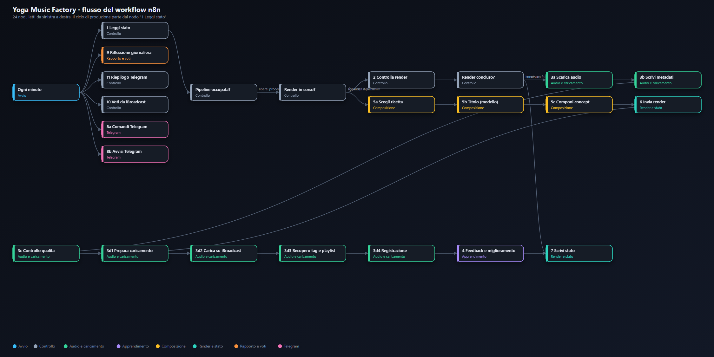
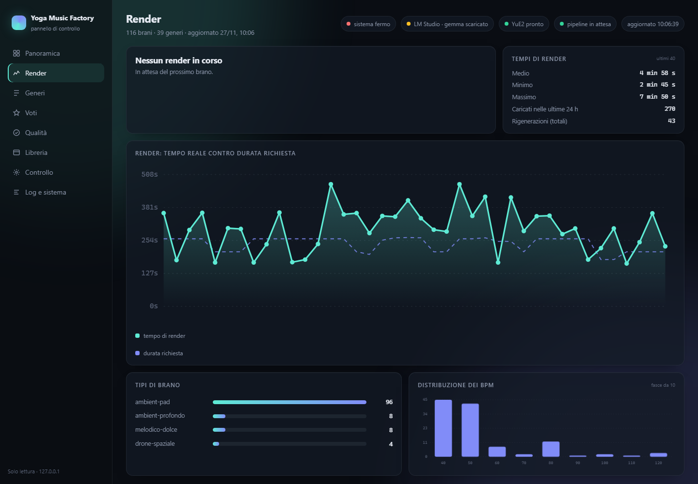
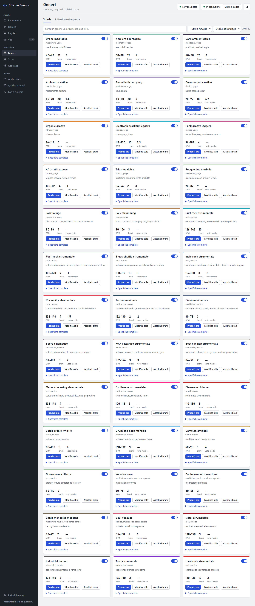
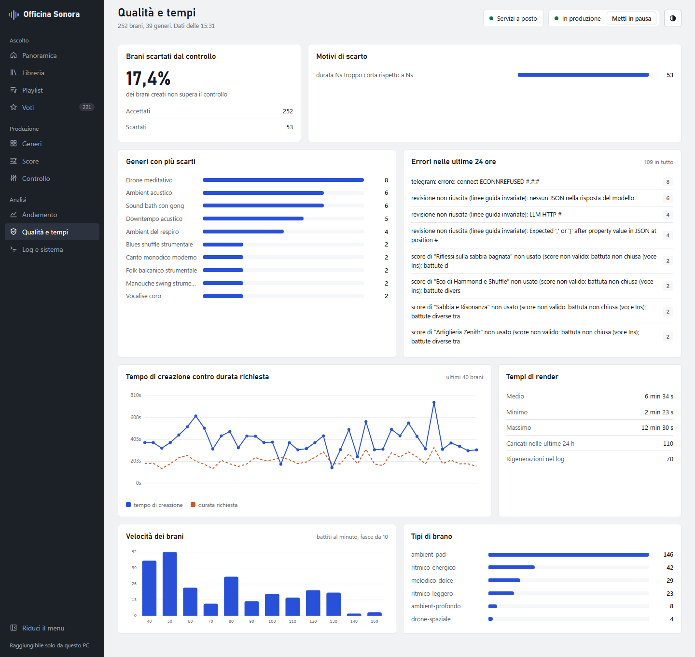
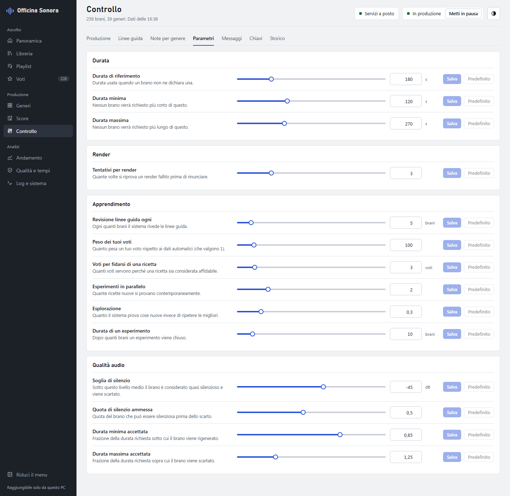
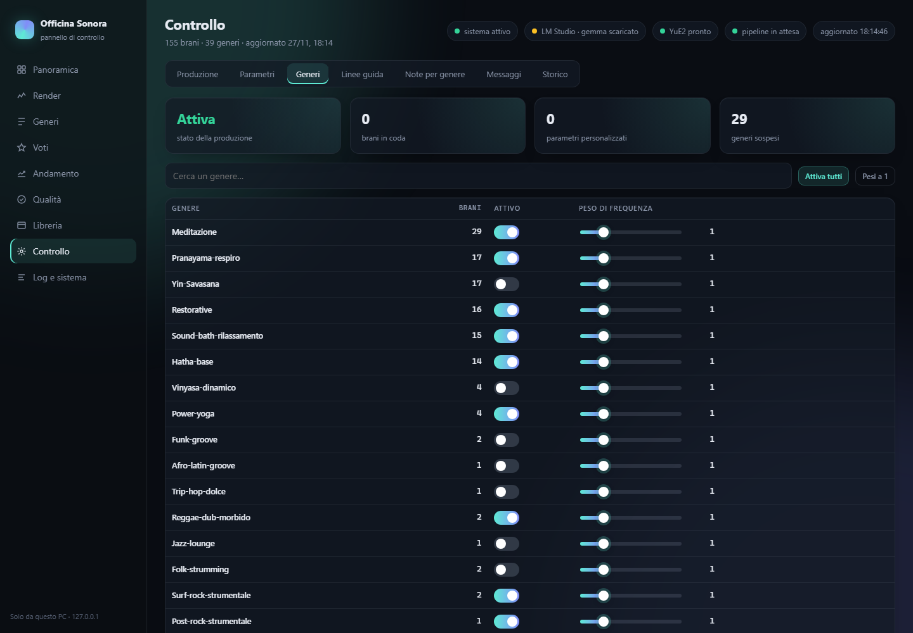
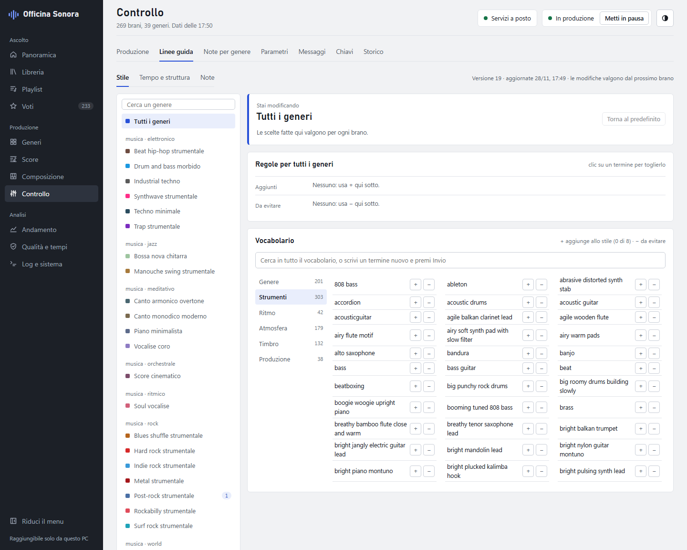
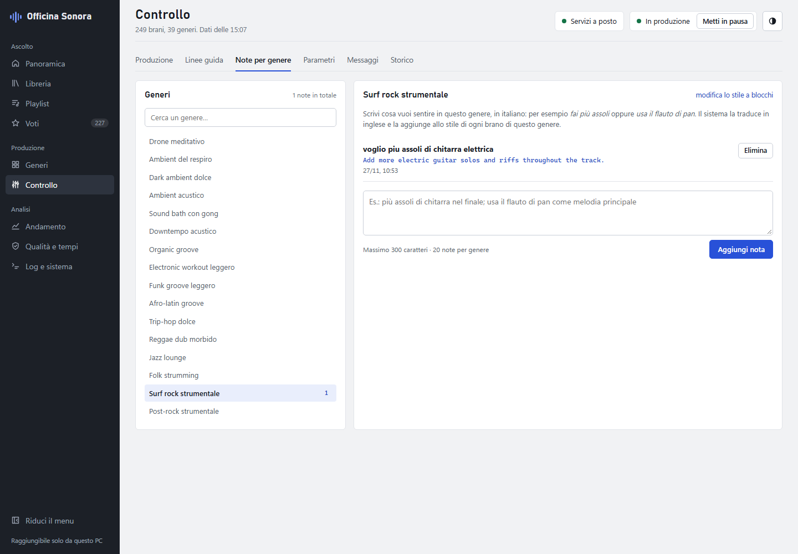

# Officina Sonora

Un sistema automatico che **compone e produce musica di sottofondo** (strumentale, o vocale senza parole) in modo
continuo, la ordina in una libreria e la pubblica su **iBroadcast** con copertine, tag e playlist.
Gira tutto sul tuo PC: **YuE2** genera l'audio, **gemma** (LM Studio) scrive titoli e analisi, **n8n** coordina.


## Indice

1. [Guida rapida](#1-guida-rapida)
2. [Come funziona](#2-come-funziona)
3. [I blocchi, uno per uno](#3-i-blocchi-uno-per-uno)
4. [Come nasce la musica](#4-come-nasce-la-musica)
5. [La dashboard](#5-la-dashboard)
6. [Telegram](#6-telegram)
7. [Votare i brani](#7-votare-i-brani)
8. [iBroadcast, copertine e metadati](#8-ibroadcast-copertine-e-metadati)
9. [Generi e libreria](#9-generi-e-libreria)
10. [Requisiti e installazione](#10-requisiti-e-installazione)
11. [Sicurezza](#11-sicurezza)
12. [Risoluzione dei problemi](#12-risoluzione-dei-problemi)
13. [Per chi sviluppa](#13-per-chi-sviluppa)
14. [Miglioramenti futuri](#14-miglioramenti-futuri)

---

## 1. Guida rapida

| Voglio... | Cosa fare |
|---|---|
| **Avviare** la produzione | doppio clic su `E:\n8n\avvia-automazione.vbs` |
| **Fermare** tutto | doppio clic su `E:\n8n\ferma-automazione.vbs` (LM Studio resta acceso) |
| **Vedere cosa succede** | apri [http://127.0.0.1:5790/dashboard](http://127.0.0.1:5790/dashboard) |
| Fare una **pausa** senza spegnere | dashboard, *Controllo → Produzione*: Metti in pausa / Riprendi |
| Produrre **subito un genere** | dashboard, *Controllo → Produzione*: scegli il genere |
| Avere **più o meno** di un genere | *Controllo → Generi*: peso da 0 (mai) a 5 |
| **Chiedere un cambiamento** a un genere | *Controllo → Note per genere*, in italiano (es. *più assoli di chitarra*) |
| **Ascoltare e votare** | scheda *Voti* (tasti 1-5), oppure `/menu` su Telegram, oppure le stelle in iBroadcast |
| Capire **se migliora** | scheda *Andamento* |
| Capire **perché un brano è stato scartato** | scheda *Qualità* e `state\tick.log` |

**Il primo giorno.** Avvia l'automazione, apri la dashboard e controlla che i quattro servizi siano attivi
(n8n, motore YuE2, LM Studio, modello gemma; gemma risulta *scaricato* durante i render, è normale).
Il primo brano arriva dopo circa 5 minuti. Vota con regolarità: senza voti il sistema non impara i tuoi gusti.

Una volta avviato, il sistema lavora da solo: un'attività pianificata (`OfficinaSonoraSupervisor`) controlla ogni
5 minuti che il watchdog sia vivo e lo riavvia. Se fermi l'automazione a mano, non la riavvia.

---

## 2. Come funziona

```
 watchdog (ogni minuto): tiene vivi gateway, n8n, LM Studio, motore YuE2
                         e scarica gemma dalla GPU durante i render

 n8n (ogni minuto)
   1 Leggi stato ── render in corso? ──no──► 5a ricetta ► 5b titolo ► 5c stile ► 5d score ► 6 invio a YuE2
                          │
                          sì
                          ▼
   2 Controlla render ── finito? ──no──► 7 Scrivi stato
                          │
                          sì
                          ▼
   3a audio e score ► 3b scheda ► 3c qualità ► 3d1-3d4 iBroadcast ► 4 apprendimento ► 7 stato

 in parallelo: 8a comandi Telegram · 8b avvisi · 9 rapporto · 10 voti iBroadcast · 11 riepilogo
```



Il diagramma è generato dal workflow con `tools\diagramma.mjs`.

Si produce **un brano alla volta**. Un file di lock (`state\pipeline.lock`) impedisce esecuzioni sovrapposte
e scade dopo 15 minuti se qualcosa si blocca. Lo stato (coda, render in corso, contatori) è in `state\state.json`.

---

## 3. I blocchi, uno per uno

Ogni blocco è un file in `src\blocks\` e un nodo *Code* in n8n. `build-workflow.mjs` incolla in testa a ciascuno
le librerie condivise (`src\lib.js`, `lib-apprendimento.js`, `lib-messaggi.js`).

### Controllo

| Blocco | Cosa fa |
|---|---|
| **1 Leggi stato** | Carica lo stato, prende il lock, esegue il comando "svuota coda" della dashboard e dice se c'è un render in corso. |
| **2 Controlla render** | Chiede al motore lo stato del job. Se è fallito, sparito o fermo da oltre 4 ore, rimette il brano in coda; dopo 3 tentativi lo abbandona. |
| **7 Scrivi stato** | Salva lo stato in modo atomico e rilascia il lock. Ci passano tutti i rami. |

### Composizione

| Blocco | Cosa fa |
|---|---|
| **5a Scegli ricetta** | Sceglie il genere (vedi [apprendimento](#come-impara)), poi struttura, tipo, fascia di bpm, variante, strumenti (due fissi del genere più 1-2 che cambiano, dalla [memoria](#la-memoria-di-composizione)), un'influenza, tonalità e durata. Non lavora se la produzione è in pausa o c'è già un brano in coda. |
| **5b Titolo** | Chiede a gemma titolo, descrizione, bpm e durata, entro i limiti del genere. Se il modello non è caricato, riprova al giro successivo. |
| **5c Componi concept** | Compone il testo di **stile** e il campo **lyrics** (la mappa delle sezioni) e mette il brano in coda. |
| **5d Componi score** | Per i brani strumentali legge la [memoria](#la-memoria-di-composizione) del genere, scrive 30 score candidati, li fa valutare al **revisore** e allega il migliore, con lyrics e durata coerenti. Se non riesce, lo score lo scrive il motore. |
| **6 Invia render** | Sceglie le **LoRA** presenti sul motore e invia a YuE2 stile, lyrics, score, durata, seed e `cot: full`. |

### Audio e pubblicazione

| Blocco | Cosa fa |
|---|---|
| **3a Scarica audio** | Scarica l'MP3 e salva accanto lo **score** (`.abc`) che il motore ha scritto e seguito. |
| **3b Scrivi metadati** | Scrive la scheda `.json` (numero progressivo, genere, ricetta, sezioni, lyrics, LoRA, seed, tempo di render) e chiude il job. |
| **3c Controllo qualità** | Verifica integrità, bitrate, durata (tra 85% e 125% di quella richiesta), livello e silenzi. Gli scartati vanno in `_scartati`; se il brano è troppo corto viene rigenerato fino a 2 volte, con uno score nuovo. Il clipping dà solo un avviso. |
| **3d1 Prepara caricamento** | Mette in coda i brani da caricare, esclude i duplicati audio, compone la copertina e scrive i tag ID3. |
| **3d2 Carica** | Invia i file a iBroadcast tramite il gateway; i falliti tornano in coda (fino a 3 tentativi). |
| **3d3 Tag e playlist** | Dopo almeno 3 minuti dal caricamento applica tag e playlist: iBroadcast li accetta solo a elaborazione finita. Ritenta fino a 30 volte. |
| **3d4 Registrazione** | Scrive nella scheda l'identificativo iBroadcast del brano. |

### Apprendimento, messaggi e voti

| Blocco | Cosa fa |
|---|---|
| **4 Feedback** | Ogni 5 brani, o quando cambiano i voti, gemma rivede gli ultimi 30 brani votati e propone nuove linee guida. Il codice accetta solo valori nei limiti e archivia la versione precedente. |
| **8a Comandi Telegram** | Risponde ai comandi, raccoglie voti e interpreta richieste in italiano, applicandole solo dopo il tuo **Conferma**. |
| **8b Avvisi** | Un errore ripetuto 3 volte in un'ora genera un avviso (al massimo uno ogni 30 minuti per tipo). |
| **9 Rapporto giornaliero** | Una volta al giorno: brani, voti, errori, salute del sistema, ricette migliori e peggiori, commento di gemma. |
| **10 Voti da iBroadcast** | Ogni 10 minuti legge stelle, tag, playlist e cestino e li trasforma in voti; applica anche `piu-veloce` / `piu-lento`. |
| **11 Riepilogo** | Alla frequenza scelta, nella fascia oraria, un messaggio con i brani caricati. |

### Servizi di supporto

| Componente | Ruolo |
|---|---|
| `gateway\server.js` (porta 5790) | Unico processo che conosce i token; parla con iBroadcast e Telegram, analizza l'audio, serve dashboard, voti e copertine. |
| `watchdog.ps1` | Ogni minuto tiene vivi gateway, n8n, LM Studio e motore; libera la GPU durante i render. |
| `supervisore.ps1` | Ogni 5 minuti riavvia il watchdog se è morto o se il suo battito è fermo da 15 minuti. |
| `stop.ps1` | Ferma watchdog, n8n, motore e gateway. |

---

## 4. Come nasce la musica

### Stile (prompt)
Si compone dalla scheda del genere in `config\catalogo.json`: identità sonora, note del produttore, strumenti
scelti, variante, influenza, enfasi, melodia, accordi, ritmica e linee guida. Le frasi ripetute vengono tolte.

### Lyrics: la mappa del brano
Anche nei brani strumentali il campo è sempre compilato, con i soli tag che la LoRA strumentale conosce:
`[intro] [verse] [pre-chorus] [chorus] [bridge] [outro]`.

| Struttura | Sezioni |
|---|---|
| `piatto` | intro, verse, bridge, verse, outro |
| `onda` | intro, verse, chorus, verse, bridge, chorus, outro |
| `arco` | intro, verse, pre-chorus, chorus, verse, bridge, chorus, outro |
| `crescendo` | intro, verse, verse, pre-chorus, chorus, bridge, pre-chorus, chorus, outro |
| `loop` | intro, verse, chorus, verse, bridge, verse, chorus, chorus, outro |

### Score ABC
Per gli strumentali lo score (melodia e accordi) lo scrive il **compositore** del progetto
(`src\compositore\`), e YuE2 lo segue:

- un **tema** per sezione, sviluppato in frasi di quattro battute (domanda, risposta, ripresa, cadenza);
- riprese trasformate (sequenza, inversione, ornamento, spostamento ritmico);
- **armonie, scale e ritmi del genere**; bridge in 3/4 o 7/8 dove lo stile lo regge;
- ritornello più alto, intro rarefatta, finale sulla tonica;
- un **revisore** dà un punteggio (qualità e novità) a 30 candidati e tiene il migliore (scritto nel log e nella scheda).

Per i generi vocali, e come ripiego, lo score lo scrive il motore. In entrambi i casi è salvato nel file `.abc`
accanto al brano. Le regole di scrittura, con le fonti, sono in [`docs/score-abc.md`](docs/score-abc.md).

### La memoria di composizione
`state\memoria-composizione.json` tiene, per ogni genere:

| Cosa | A cosa serve |
|---|---|
| **identità**: 3 progressioni, 4 celle ritmiche per livello di energia, 3 modi di variare il tema, registro, metro del bridge | brani dello stesso genere **riconoscibili** |
| **strumenti fissi** (2) e ultima combinazione degli altri | stesso colore, abbinamenti che cambiano |
| **brani composti** (ultimi 200): seed, parametri e impronta di tema, ritmi e armonie | brani **mai uguali**: un tema già usato viene escluso e il revisore premia la novità |
| **voti** (letti dalle schede dei brani) | miglioramento continuo |

Come impara dai voti:
- progressioni, celle e variazioni dei brani votati 4-5 vengono scelte **più spesso**, quelle dei brani votati 1-2 meno;
- un elemento con almeno due voti e media 2 o meno **esce** dall'identità del genere e ne entra uno nuovo.

Vale per gli score del compositore; i generi vocali e i ripieghi con lo score del motore non vi partecipano.
La memoria non è su Git: va inclusa nei backup insieme alla libreria. Se il file si rovina viene messo da parte
(`.corrotta`) e si riparte da vuota. Per ridare un'identità nuova a un genere, a produzione ferma elimina la
sua voce dal file.

Un brano scartato perché troppo corto viene rigenerato con uno **score nuovo** del compositore.

### LoRA
Gli strumentali usano `yue2-instrumental` (pensata per lo score); se manca, `yue2-instrumental-kto`.
I generi vocali non usano LoRA strumentali. Alcuni generi ne aggiungono una propria (campo `lora` del catalogo):

| Generi | LoRA di genere |
|---|---|
| Metal, Hard rock | slider metal |
| Industrial techno | industrial rock |
| Indie rock, Post-rock | slider indie rock |
| Techno minimale | slider house |
| Synthwave | keygen music |
| Hip-hop, Trip-hop | slider lo-fi |
| Funk | slider disco funk |
| Afro-latin | slider afrobeats |
| Folk, Celtic | slider acoustic folk |
| Score cinematico | epic trailer |

Se un render fallisce (per esempio perché le LoRA sovrapposte producono uno score illeggibile), il secondo
tentativo parte senza la LoRA di genere e con lo score scritto dal motore, e il terzo con la configurazione più collaudata (`yue2-instrumental-kto`,
score di sola melodia).

Una LoRA assente dal motore viene saltata e annotata nel log. Le scale scelte sono un punto di partenza,
da correggere con l'ascolto.

> **Licenza.** I pesi di YuE2 e molte LoRA sono **CC BY-NC** (non commerciale). Prima di usare i brani a scopo
> commerciale, verifica le condizioni con gli autori.

### Come impara
- **Ricette.** Ogni combinazione genere, tipo, struttura e fascia di bpm ha un punteggio. Un tuo voto pesa
  come 100 dati automatici. Le ricette nuove entrano come esperimenti, in numero limitato.
- **Rotazione.** I generi con meno brani in libreria hanno la precedenza, corretta dal peso che gli assegni;
  gli ultimi generi prodotti non tornano subito.
- **Linee guida.** Il blocco 4 aggiorna parole di stile, durate, bpm e strutture preferite (`config\guidance.json`).

---

## 5. La dashboard

[http://127.0.0.1:5790/dashboard](http://127.0.0.1:5790/dashboard), **solo da questo PC**. Si aggiorna ogni 5 secondi.

| Scheda | Cosa trovi |
|---|---|
| **Panoramica** | numeri chiave, produzione degli ultimi 14 giorni, render in corso, servizi |
| **Render** | tempi di render, durata ottenuta contro richiesta, bpm e tipi |
| **Generi** | brani e stato di ogni genere |
| **Voti** | ascolto e voto dei brani |
| **Andamento** | il sistema sta migliorando? |
| **Qualità** | scarti, motivi, errori delle ultime 24 ore |
| **Libreria** | brani recenti e caricamenti |
| **Controllo** | tutte le impostazioni |
| **Log e sistema** | servizi, sorveglianza, esecuzioni n8n, log |

### Render e generi



### Voti


### Andamento


Quattro grafici: voto medio, brani scartati, secondi di render per secondo di musica buona, errori.
Passo per ora (48 ore) o per giorno (60 giorni). Il voto è collocato quando il brano è stato **generato**.
Le linee tratteggiate indicano le tue modifiche e le nuove linee guida. Il giudizio confronta gli ultimi
7 giorni con i 7 precedenti:

| Giudizio su | Minimo per periodo | Soglia di cambiamento |
|---|---|---|
| Voto medio | 10 brani votati | 0,2 stelle |
| Brani scartati | 30 brani | 5 punti percentuali |

Sotto la soglia il giudizio è *stabile*, sotto il minimo *dati insufficienti*.

### Qualità e libreria



### Controllo
Le modifiche valgono dal brano successivo e sono registrate nello **Storico** con il valore precedente.

| Sezione | Cosa fa |
|---|---|
| Produzione | pausa e ripresa, svuota coda, produci un genere, genera gli sfondi delle copertine |
| Parametri | durata, esplorazione, peso dei voti, soglie di qualità (ognuno con limiti) |
| Generi | attiva o sospende, regola il peso |
| Linee guida | stile da aggiungere o evitare, bpm per genere |
| Note per genere | richieste in italiano, tradotte e aggiunte allo stile |
| Messaggi | frequenza, orari e contenuto dei messaggi Telegram |
| Storico | tutte le modifiche |








### Log e sistema


---

## 6. Telegram

Il bot manda il **riepilogo** dei brani (predefinito: ogni ora dalle 8 alle 22; quelli della notte arrivano
alle 8), il **rapporto giornaliero** e gli **avvisi** per errori ripetuti. Fuori fascia i messaggi automatici
aspettano; le risposte ai tuoi comandi arrivano sempre.

| Comando | Cosa fa |
|---|---|
| `/menu` | menu a pulsanti, compreso **Vota un brano** |
| `/stato` | brani, coda, errori |
| `/annulla` | scarta le modifiche in attesa |
| `/aiuto` | elenco dei comandi |

Puoi anche scrivere in italiano cosa cambiare (*"Vinyasa più ritmato, bpm tra 100 e 120"*): il bot riassume
la modifica e la applica solo dopo il tuo **Conferma**.

---

## 7. Votare i brani

Voti da 1 a 5, salvati nella scheda `.json` del brano, che è l'unica fonte.

- **Dashboard** (scheda *Voti*): un brano alla volta, stelle o tasti **1-5**, nota facoltativa (massimo
  300 caratteri, senza `<` o `>`), *Salta*, filtro per genere, *Votati ora* per correggere. La coda esclude
  scartati e brani generati da meno di 15 minuti.
- **Telegram**: `/menu` → *Vota un brano* (gli 8 più recenti), voto e nota.
- **iBroadcast**: stelle; tag o playlist `preferito`, `scarta`, `voto-N`; cestino (vale 1). Le stelle prevalgono
  sui tag, e i tag sul cestino. I tag `piu-veloce` / `piu-lento` spostano il bpm del genere di 6 (entro 15 dalla base).
  I tag e le playlist creati dal sistema non contano.

**Vince l'ultimo.** Un segnale di iBroadcast sostituisce il voto solo quando **cambia** (lettura ogni 10 minuti);
se lo togli, il voto resta. I voti dati da dashboard e Telegram non vengono scritti su iBroadcast.

---

## 8. iBroadcast, copertine e metadati

Ogni brano su [ibroadcast.com](https://ibroadcast.com) ha titolo, copertina, numero di traccia unico, album
(il nome del genere; i brani più vecchi hanno il nome della categoria), tag (ambito, famiglia, categoria,
energia, struttura, tipo) e playlist `Yoga - <categoria>` o `Musica - <categoria>`.

Gli MP3 hanno tag ID3 completi (anche bpm, tonalità, mood, strumenti, variante e seed come campi aggiuntivi).

La **copertina** è uno sfondo del genere generato con Stable Diffusion, con titolo, genere e artista:

1. *Controllo → Produzione*: **Metti in pausa e genera gli sfondi** (8 per genere; si può interrompere e riprendere).
   Per rifarne uno cancella il file in `assets\sfondi\<categoria>` (`_foglio.jpg` li mostra tutti).
2. Il prompt di ogni genere è nel campo `copertina` del catalogo.
3. Per aggiornare i brani già online: prima `node tools\ripubblica.js --prova <a.json> <b.json> <c.json>`
   (almeno uno con le stelle), controlla nell'app, poi `node tools\ripubblica.js --tutti`. La vecchia copia si
   cestina solo dopo che la nuova ha tag, playlist e voti; il conteggio degli ascolti riparte da zero.

---

## 9. Generi e libreria

Tre livelli: **ambito** (`Yoga` o `Sottofondo`), **famiglia** (meditativo, ritmico, rock, elettronico,
orchestrale, world, jazz) e **categoria** (il genere preciso). Il catalogo ha **39 generi**.

```
E:\Musica di sottofondo\
  Yoga\<famiglia>\<categoria>\<tipo>\        brano.mp3 + brano.json + brano.abc
  Sottofondo\<famiglia>\<categoria>\<tipo>\  brano.mp3 + brano.json + brano.abc
  _scartati\                                 brani non superati dal controllo qualità
```

I brani prodotti prima del salvataggio dello score non hanno il file `.abc`.

**Aggiungere un genere:** in `config\catalogo.json` aggiungi `name`, `ambito`, `famiglia`, `energia` (1-5),
`bpm`, `attivita`, `strutture`, `genere`, `stile`, `strumenti`, `vietati`, `influenze`, `enfasi`, `melodia`,
`accordi`, `ritmica`, `tonalita`, `varianti`, `colori`; facoltativi `lora`, `copertina` e
`vocale_senza_parole`. Poi ricostruisci e pubblica il workflow.

---

## 10. Requisiti e installazione

Windows 11 con GPU NVIDIA (qui una RTX 3060 Laptop da 6 GB).

| Componente | Dove | Note |
|---|---|---|
| n8n 2.x | `E:\n8n` | installato con npm |
| Node.js 24 | nel PATH | gateway e test |
| YuE2 Studio | `E:\MusicAI\YuE2 Studio` | motore yue2.cpp sulla porta 18087, LoRA in `data\adapters` |
| LM Studio | porta 1234 | modello `google/gemma-4-e4b` |
| Account iBroadcast e bot Telegram | | token cifrati in `secrets\` |

Non sono nel repository: n8n, i file `avvia-automazione.vbs` e `ferma-automazione.vbs` (in `E:\n8n`), motore e
modelli, libreria audio, `secrets\`, `state\`, gli sfondi e `config\telegram.json`.

---

## 11. Sicurezza

- Token Telegram e iBroadcast cifrati con **DPAPI**: leggibili solo dal tuo utente su questo PC.
- Solo il **gateway** li conosce; i blocchi n8n lo chiamano su `127.0.0.1`.
- Il gateway accetta solo richieste dal tuo PC (`127.0.0.1:5790` o `localhost:5790`) e rifiuta le scritture
  inviate da pagine di altri siti. La dashboard non mostra token; l'audio si chiede per numero, mai per percorso.
- Per rinnovare l'accesso a iBroadcast: `ibroadcast-login.ps1`. Per Telegram: aggiorna `secrets\telegram.dpapi`.
- `config\telegram.json` va creato a mano: `{ "chat_id": 000000000 }` con il tuo identificativo.

---

## 12. Risoluzione dei problemi

| Sintomo | Cosa fare |
|---|---|
| La dashboard non si apre | l'automazione è ferma: `avvia-automazione.vbs` |
| Nessun brano da molto | controlla i servizi in dashboard e che la produzione non sia in pausa |
| Il motore non risponde | il watchdog lo riavvia; vedi `state\watchdog.log` |
| "riaccodo ... failed" nel log | il motore non ha completato il render: il ripiego è automatico |
| Molti brani "troppo corti" | limite noto (vedi miglioramenti); le soglie sono in *Controllo → Parametri* |
| Voci in un brano strumentale | vota 1 con una nota; la LoRA in uso è registrata nella scheda |
| "revisione non riuscita: LLM HTTP 400" | gemma non era caricato: le linee guida restano invariate |
| "token non valido" | rinnova il token (vedi Sicurezza) |
| Un brano manca su iBroadcast | cerca in `state\tick.log` e `state\errori.jsonl` |

Log: `state\tick.log` (produzione), `state\watchdog.log` (servizi), `state\supervisore.log` (supervisore),
`state\errori.jsonl` (errori).

---

## 13. Per chi sviluppa

| Cartella / file | Contenuto |
|---|---|
| `src\blocks\` | i blocchi del workflow |
| `src\lib*.js`, `src\cover.js` | funzioni condivise |
| `src\compositore\` | compositore, revisore, scrittura e validazione dello score ABC |
| `config\` | catalogo, linee guida e storico, parametri |
| `gateway\` | servizio locale e dashboard |
| `tools\` | manutenzione, prove sul motore (`prove\`), test (`test\`) |
| `docs\superpowers\` | documenti di progetto e piani |
| `officina-sonora-workflow.json` | workflow generato |

```powershell
node --test tools/test/*.test.js
```

Il test `rotazione` si basa sul caso e ogni tanto va ripetuto.

**Pubblicare una modifica** (da `E:\n8n\officina-sonora`, poi da `E:\n8n` con `N8N_USER_FOLDER=E:\n8n\data`):

```powershell
node build-workflow.mjs
```
```powershell
.\node_modules\.bin\n8n.cmd import:workflow --input=E:/n8n/officina-sonora/officina-sonora-workflow.json
```
```powershell
.\node_modules\.bin\n8n.cmd publish:workflow --id=yogaMusicFactory01
```

n8n in esecuzione applica la nuova versione da sé; il render in corso continua. L'identificativo del workflow
è rimasto quello originario. Se cambi file in `gateway\`, riavvia anche il gateway.

**Screenshot e diagramma:** `tools\screenshot.ps1` (gateway attivo) e `node tools\diagramma.mjs`.
`tools\pubblica.ps1 -Messaggio "..."` li rigenera, committa e invia su GitHub.

**Prove sul motore:** `node tools/prove/prove-motore.js` confronta score, lyrics e LoRA e crea una pagina di
ascolto in `state\prove\`. Occupa la GPU: va eseguito solo a produzione ferma.

**Regola di progetto:** ogni modifica importante aggiorna questo README (vedi `CLAUDE.md`).

---

## 14. Miglioramenti futuri

In ordine di priorità. Il disegno completo è in
[`docs/superpowers/specs`](docs/superpowers/specs/2026-11-27-processo-artistico-design.md).

| # | Miglioramento | Perché |
|---|---|---|
| 1 | **Giudicare a orecchio gli score del compositore** e correggere forme, ritmi e armonie in base ai voti | la qualità musicale non è verificabile dai test |
| 2 | **Brani troppo corti**: controllare se con lo score nostro il problema sparisce, altrimenti agire su token e LoRA | circa un brano su tre è stato scartato finora |
| 3 | **Compositore più ricco**: contrappunto, soli, fill, cambi di tonalità, finali | più varietà e dettagli |
| 4 | **Schede artistiche per i 39 generi**: forme, progressioni, ritmi, chicche, prompt in inglese, durata 3-6 minuti | generi più distinti; oggi lo stile mescola italiano e inglese |
| 5 | **Calibrazione delle LoRA** e forme delle lyrics (anche con tempi) | le scale attuali non sono validate a orecchio |
| 6 | **Dashboard**: score, sezioni, punteggio del revisore e motivo dei render falliti; mostrare la memoria di ogni genere | rendere visibile cosa funziona |
| 7 | **Agente di ricerca locale** (DuckDuckGo e fonti di teoria, gemma), con approvazione in dashboard | miglioramento artistico continuo |
| 8 | Eseguire la revisione delle linee guida quando gemma è caricato | oggi spesso fallisce durante i render |
| 9 | Validazione più severa dello score (blocchi, ordine delle voci, nomi delle sezioni) | allinearla al validatore ufficiale |
