# Officina Sonora

**Una piccola fabbrica di musica di sottofondo che lavora da sola sul tuo computer.**

Inventa brani strumentali (o con voci senza parole) per yoga, studio o relax, controlla che siano riusciti, li mette
in ordine e li carica sul tuo spazio musicale in rete (**iBroadcast**) con copertina e playlist. Tu ascolti, dai un
voto e, se vuoi, chiedi cambiamenti: il sistema ne tiene conto per i brani successivi.


## Le parole da conoscere

| Parola | Significato |
|---|---|
| **Brano** | un pezzo musicale prodotto dal sistema |
| **Genere** | il tipo di musica (ne esistono 39) |
| **Dashboard** | la pagina web da cui controlli tutto |
| **Render** | il momento in cui il computer crea l'audio; dura alcuni minuti |
| **YuE2** | il programma che **crea la musica** |
| **gemma** | il programma che **scrive** titoli, descrizioni e analisi (gira dentro *LM Studio*) |
| **n8n** | il «direttore d'orchestra» che fa eseguire i passi nell'ordine giusto |
| **Gateway** | il piccolo servizio che fa funzionare la dashboard |
| **Watchdog / supervisore** | i guardiani che riavviano i programmi se si fermano |
| **Prompt** o **stile** | la descrizione in inglese del brano data a YuE2 |
| **Score** | lo spartito che guida la creazione di un brano |
| **BPM** | battiti al minuto: la velocità della musica |

## Indice

1. [Guida rapida](#1-guida-rapida)
2. [Come funziona](#2-come-funziona)
3. [I blocchi, uno per uno](#3-i-blocchi-uno-per-uno)
4. [Come nasce la musica](#4-come-nasce-la-musica)
5. [La dashboard](#5-la-dashboard)
6. [Telegram](#6-telegram)
7. [Votare i brani](#7-votare-i-brani)
8. [iBroadcast, copertine e metadati](#8-ibroadcast-copertine-e-metadati)
9. [Generi e libreria](#9-generi-e-libreria)
10. [Requisiti e installazione](#10-requisiti-e-installazione)
11. [Sicurezza](#11-sicurezza)
12. [Risoluzione dei problemi](#12-risoluzione-dei-problemi)
13. [Per chi sviluppa](#13-per-chi-sviluppa)
14. [Miglioramenti futuri](#14-miglioramenti-futuri)

---

## 1. Guida rapida

### Il primo giorno, in quattro passi

1. **Accendi**: doppio clic su `E:\n8n\avvia-automazione.vbs`.
2. **Apri la dashboard**: [http://127.0.0.1:5790/dashboard](http://127.0.0.1:5790/dashboard).
3. **Controlla in alto a destra**: *Servizi a posto* e *In produzione*.
4. **Aspetta il primo brano** (circa 5-10 minuti), premi sulla sua copertina per ascoltarlo e dagli un voto.

Da qui in poi il sistema lavora da solo. Ogni 5 minuti un controllo automatico verifica che sia vivo e, se serve, lo
riavvia; se l'hai fermato tu, non lo riavvia. **Vota con regolarità**: senza voti non può imparare i tuoi gusti.

### Cosa voglio fare?

| Voglio... | Dove andare |
|---|---|
| **Avviare** la produzione | doppio clic su `E:\n8n\avvia-automazione.vbs` |
| **Spegnere** tutto | doppio clic su `E:\n8n\ferma-automazione.vbs`; resta spento finché non riavvii tu (LM Studio resta acceso) |
| Fare una **pausa** senza spegnere | *Metti in pausa* in alto a destra, in ogni pagina; su Telegram `/pausa` e `/riprendi` |
| **Vedere se funziona** | [Panoramica](#panoramica): la riga delle fasi e gli eventuali avvisi |
| **Ritrovare e riascoltare** un brano | [Libreria](#libreria) (tasto `/` per cercare) |
| **Ascoltare** di seguito, in ordine o a caso | *Riproduci* o *Casuale* in [Libreria](#libreria) e [Playlist](#playlist); vedi [Il lettore](#il-lettore) |
| **Preparare la musica per una lezione** | una [playlist](#playlist), con [dissolvenza e timer di spegnimento](#timer-dissolvenza-e-scorciatoie) |
| **Dare un voto** | stelle nel [lettore](#il-lettore), pagina [Voti](#voti), `/menu` su Telegram o stelle in iBroadcast |
| **Scaricare** un brano o vedere come è stato fatto | clic sul titolo: [scheda del brano](#la-scheda-del-brano) |
| Avere **subito** un certo genere | [Generi](#generi): *Produci ora* |
| **Sospendere** un genere o farlo uscire di più | [Generi](#generi): interruttore sulla scheda, peso in *Attivazione e frequenza* |
| **Chiedere un cambiamento** a parole | [Note per genere](#note-per-genere), in italiano |
| **Scegliere i termini** dello stile | [Linee guida](#linee-guida) |
| Capire **se migliora** | [Andamento](#andamento) |
| Capire **perché un brano è stato scartato** | [Qualità e tempi](#qualità-e-tempi) e [Log e sistema](#log-e-sistema) |

---

## 2. Come funziona

**In parole semplici**, ogni brano passa da questi passi, uno alla volta:

1. il sistema **sceglie** genere, strumenti e forma, dando precedenza a ciò che hai votato bene;
2. **gemma** inventa titolo e descrizione;
3. si prepara lo **spartito** e **YuE2** crea l'audio (la parte più lunga);
4. il volume viene reso uniforme e il brano **controllato**: se non va bene viene rifatto;
5. se è buono, viene salvato, **caricato** su iBroadcast e compare nella dashboard;
6. i tuoi **voti** guidano le scelte successive.

Lo schema seguente è per chi vuole i dettagli.

```
 watchdog (ogni minuto): tiene vivi gateway, n8n, LM Studio, motore YuE2
                         e scarica gemma dalla GPU durante i render

 n8n (ogni minuto)
   1 Leggi stato ── render in corso? ──no──► 5a ricetta ► 5b titolo ► 5c stile ► 5d ripiego ► 6 invio a YuE2
                          │
                          sì
                          ▼
   2 Controlla render ── finito? ──no──► 7 Scrivi stato
                          │
                          sì
                          ▼
   3a audio e score ► 3b scheda ► 3c qualità ► 3d1-3d4 iBroadcast ► 4 apprendimento ► 7 stato

 in parallelo: 8a comandi Telegram · 8b avvisi · 9 rapporto · 10 voti iBroadcast · 11 riepilogo
```


Il diagramma è generato dal workflow con `tools\diagramma.mjs`.

Si produce **un brano alla volta**. Un file di lock (`state\pipeline.lock`) impedisce esecuzioni sovrapposte
e scade dopo 15 minuti se qualcosa si blocca. Lo stato (coda, render in corso, contatori) è in `state\state.json`.

---

## 3. I blocchi, uno per uno

Ogni blocco è un file in `src\blocks\` e un nodo *Code* in n8n. `build-workflow.mjs` incolla in testa a ciascuno
le librerie condivise (`src\lib.js`, `lib-apprendimento.js`, `lib-messaggi.js`).

### Orchestrazione

| Blocco | Cosa fa |
|---|---|
| **1 Leggi stato** | Carica lo stato, prende il lock, esegue il comando "svuota coda" della dashboard e dice se c'è un render in corso. |
| **2 Controlla render** | Chiede al motore lo stato del job. Quando è pronto lo **score**, lo rende strumentale, ne ricava durata e lyrics e avvia il render dell'audio; se lo score non va bene ne chiede un altro (3 in tutto). Un render fallito, sparito o fermo da oltre 4 ore torna in coda; dopo 3 tentativi lo abbandona. |
| **7 Scrivi stato** | Salva lo stato in modo atomico e rilascia il lock. Ci passano tutti i rami. Se lo stato risulta illeggibile ne viene tenuta una copia (`.corrotto`). |

### Composizione

| Blocco | Cosa fa |
|---|---|
| **5a Scegli ricetta** | Sceglie il genere (vedi [apprendimento](#come-impara)), poi struttura, tipo, fascia di bpm, variante, strumenti (due fissi del genere più 1-2 che cambiano, dalla [memoria](#la-memoria-di-composizione)), un'influenza, tonalità e durata. Non lavora se la produzione è in pausa o c'è già un brano in coda. |
| **5b Titolo** | Chiede a gemma titolo, descrizione, bpm e durata, entro i limiti del genere. Gli indica le prime parole dei titoli recenti da non ripetere. Se il modello non è caricato, riprova al giro successivo. |
| **5c Componi concept** | Compone il testo di **stile** in inglese e il campo **lyrics** (la mappa delle sezioni) e mette il brano in coda. |
| **5d Componi score** | Prepara lo score di **ripiego** del compositore (30 candidati valutati dal revisore, [memoria](#la-memoria-di-composizione) del genere): si usa solo se il modello non ne scrive uno valido. |
| **6 Invia render** | Toglie gemma dalla GPU, sceglie le **LoRA** presenti sul motore e chiede a YuE2 lo score (strumentali) oppure direttamente l'audio (voci e ripieghi). Se il motore rifiuta la stessa richiesta 5 volte, il brano viene abbandonato. |

### Audio e pubblicazione

| Blocco | Cosa fa |
|---|---|
| **3a Scarica audio** | Scarica il WAV, lo fa passare dal [mastering](#mastering) (MP3 a 320 kbps) e salva accanto lo **score** (`.abc`) seguito dal motore. |
| **3b Scrivi metadati** | Scrive la scheda `.json` (numero progressivo, genere, ricetta, sezioni, lyrics, LoRA, seed, tempo di render) e chiude il job. |
| **3c Controllo qualità** | Verifica integrità, bitrate, durata (tra 85% e 125% di quella richiesta), livello e silenzi. Gli scartati vanno in `_scartati`; se il brano è troppo corto viene rigenerato fino a 2 volte, con uno score nuovo. Il clipping dà solo un avviso. |
| **3d1 Prepara caricamento** | Mette in coda i brani da caricare, esclude i duplicati audio, compone la copertina e scrive i tag ID3. |
| **3d2 Carica** | Invia i file a iBroadcast tramite il gateway. Vale come caricato solo ciò che iBroadcast conferma; i falliti si ritentano 3 volte e poi di nuovo ogni ora. |
| **3d3 Tag e playlist** | Dopo almeno 3 minuti dal caricamento applica tag e playlist: iBroadcast li accetta solo a elaborazione finita. Ritenta fino a 30 volte. |
| **3d4 Registrazione** | Scrive nella scheda l'identificativo iBroadcast del brano. |

### Apprendimento, messaggi e voti

| Blocco | Cosa fa |
|---|---|
| **4 Feedback** | Ogni 5 brani, o quando cambiano i voti, il blocco carica gemma, che rivede gli ultimi 30 brani votati e propone nuove linee guida. I termini di stile che propone sono presi dal vocabolario e valgono solo per i generi dei brani votati (`stile_generi` in `configguidance.json`, visibili in *Controllo → Linee guida* e su Telegram); non modifica i blocchi scelti da te. Il codice accetta solo valori nei limiti e archivia la versione precedente. |
| **8a Comandi Telegram** | Risponde ai comandi, raccoglie voti e interpreta richieste in italiano, applicandole solo dopo il tuo **Conferma**. |
| **8b Avvisi** | Un errore ripetuto 3 volte in un'ora genera un avviso (al massimo uno ogni 30 minuti per tipo). |
| **9 Rapporto giornaliero** | Una volta al giorno: brani, voti, errori, salute del sistema, ricette migliori e peggiori, commento di gemma. |
| **10 Voti da iBroadcast** | Ogni 10 minuti legge stelle, tag, playlist e cestino e li trasforma in voti; applica anche `piu-veloce` / `piu-lento`. |
| **11 Riepilogo** | Alla frequenza scelta, nella fascia oraria, un messaggio con i brani caricati. |

### Servizi di supporto

| Componente | Ruolo |
|---|---|
| `gateway\server.js` (porta 5790) | Unico processo che conosce i token; parla con iBroadcast e Telegram, analizza l'audio, serve dashboard, voti e copertine. |
| `watchdog.ps1` | Ogni minuto tiene vivi gateway, n8n, LM Studio e motore; libera la GPU durante i render. |
| `supervisore.ps1` | Ogni 5 minuti riavvia il watchdog se è morto o se il suo battito è fermo da 15 minuti. |
| `stop.ps1` | Ferma watchdog, n8n, motore e gateway. |

---

## 4. Come nasce la musica

### Stile (prompt)
È in **inglese**, fatto di soli descrittori e sempre nello stesso ordine: `Instrumental`, genere, strumenti con
timbro e tecnica, variante, ritmo, atmosfera, influenza, note del produttore, linee guida, spazio e mix,
**BPM**, **tonalità**, `no vocals`. I descrittori di ogni genere sono nel campo `en` di `config\catalogo.json`
(`genre`, `instruments`, `rhythm`, `mood`, `space`, `influences`). Ogni termine è un **blocco**:
dalla dashboard puoi aggiungerne o escluderne, per tutti i generi o per uno solo (fissi: tipo, BPM, tonalità e
`no vocals`). YuE2 non ha un prompt negativo (la documentazione ufficiale non prevede `negative_prompt`), quindi
un blocco "da evitare" viene **tolto dallo stile**; il campo `vietati` del catalogo resta informativo.

### Lyrics: la mappa del brano
Anche nei brani strumentali il campo è sempre compilato, con i soli tag che la LoRA strumentale conosce:
`[intro] [verse] [pre-chorus] [chorus] [bridge] [outro]`.

| Struttura | Sezioni |
|---|---|
| `piatto` | intro, verse, bridge, verse, outro |
| `onda` | intro, verse, chorus, verse, bridge, chorus, outro |
| `arco` | intro, verse, pre-chorus, chorus, verse, bridge, chorus, outro |
| `crescendo` | intro, verse, verse, pre-chorus, chorus, bridge, pre-chorus, chorus, outro |
| `loop` | intro, verse, chorus, verse, bridge, verse, chorus, chorus, outro |

### Score ABC
Per gli strumentali segue la procedura ufficiale di YuE, in due passi:

1. il **modello** scrive lo score (richiesta da un secondo di audio, senza LoRA);
2. il codice sposta la melodia dalla voce `Vocal` agli strumenti, lasciando in `Vocal` pause e accordi, e controlla
   la sintassi (`src\compositore\abc.js`);
3. il motore rende l'audio seguendo quello score, con le LoRA.

Uno score illeggibile, troncato o di durata inadatta (meno del 75% di quella richiesta, meno di 2 minuti o più di
5 minuti e mezzo) viene richiesto di nuovo. Nei ritenti lo score si chiede senza `Instrumental` e `no vocals` (con quelle parole il modello a volte
ripete un interlude senza fine). Dopo 3 tentativi si usa lo score del **compositore** del progetto
(ripiego), e dopo un render fallito quello che il motore scrive da sé. La scheda del brano dice chi l'ha scritto
(`score_fonte`: `modello`, `compositore` o `motore`). Le regole di scrittura sono in [`docs/score-abc.md`](docs/score-abc.md).

### Durata
La decide lo score. Il render chiede il 15% in più e impone un minimo (`min_tokens`, 90% dello score) sotto il
quale il motore non può chiudere il brano.

### Mastering
Il gateway (`gateway\master.js`, con ffmpeg) porta ogni brano a **-16 LUFS** con picco massimo -1 dB, aggiunge una
dissolvenza di 3 secondi e salva in **MP3 a 320 kbps**. Dopo un render fallito si chiede al motore direttamente
l'MP3, senza mastering.

### La memoria di composizione
`state\memoria-composizione.json` tiene, per ogni genere:

| Cosa | A cosa serve |
|---|---|
| **identità**: 3 progressioni, 4 celle ritmiche per livello di energia, 3 modi di variare il tema, registro, metro del bridge | brani dello stesso genere **riconoscibili** |
| **strumenti fissi** (2) e ultima combinazione degli altri | stesso colore, abbinamenti che cambiano |
| **brani composti** (ultimi 200): seed, parametri e impronta di tema, ritmi e armonie | brani **mai uguali**: un tema già usato viene escluso e il revisore premia la novità |
| **voti** (letti dalle schede dei brani) | miglioramento continuo |

Come impara dai voti:
- progressioni, celle e variazioni dei brani votati 4-5 vengono scelte **più spesso**, quelle dei brani votati 1-2 meno;
- un elemento con almeno due voti e media 2 o meno **esce** dall'identità del genere e ne entra uno nuovo.

Vale per gli score del compositore, oggi usati come ripiego; gli score del modello e i generi vocali non vi partecipano.
La memoria non è su Git: va inclusa nei backup insieme alla libreria. Se il file si rovina viene messo da parte
(`.corrotta`) e si riparte da vuota. Per ridare un'identità nuova a un genere, a produzione ferma elimina la
sua voce dal file.

Un brano scartato perché troppo corto viene rigenerato con uno **score nuovo** del compositore.

### LoRA
Gli strumentali usano `yue2-instrumental-kto`. L'altra LoRA strumentale installata (`yue2-instrumental`) è
esclusa: in produzione il motore chiudeva i brani dopo 30 secondi.
I generi vocali non usano LoRA strumentali. Alcuni generi ne aggiungono una propria (campo `lora` del catalogo):

| Generi | LoRA di genere |
|---|---|
| Metal, Hard rock | slider metal |
| Industrial techno | industrial rock |
| Indie rock, Post-rock | slider indie rock |
| Techno minimale | slider house |
| Synthwave | keygen music |
| Hip-hop, Trip-hop | slider lo-fi |
| Funk | slider disco funk |
| Afro-latin | slider afrobeats |
| Folk, Celtic | slider acoustic folk |
| Score cinematico | epic trailer |

Lo score si chiede senza LoRA: agiscono solo sul render.

Se un render fallisce (per esempio perché le LoRA sovrapposte producono uno score illeggibile), il secondo
tentativo parte senza la LoRA di genere e con lo score scritto dal motore, e il terzo con lo score di sola melodia.
Anche il secondo ritento di un brano troppo corto parte senza LoRA di genere.

Una LoRA assente dal motore viene saltata e annotata nel log. Le scale scelte sono un punto di partenza,
da correggere con l'ascolto.

> **Licenza.** I pesi di YuE2 e molte LoRA sono **CC BY-NC** (non commerciale). Prima di usare i brani a scopo
> commerciale, verifica le condizioni con gli autori.

### Come impara
- **Ricette.** Ogni combinazione genere, struttura e fascia di bpm (ciò che arriva al motore) ha un punteggio.
  Il tipo (cartella e tag) segue l'energia del genere. Un tuo voto pesa
  come 100 dati automatici. Le ricette nuove entrano come esperimenti, in numero limitato.
- **Rotazione.** I generi con meno brani in libreria hanno la precedenza, corretta dal peso che gli assegni;
  gli ultimi generi prodotti non tornano subito.
- **Linee guida.** Il blocco 4 aggiorna parole di stile, durate, bpm e strutture preferite (`config\guidance.json`).

---

## 5. La dashboard

La **dashboard** è la pagina web da cui controlli tutto. Si apre con il browser su
[http://127.0.0.1:5790/dashboard](http://127.0.0.1:5790/dashboard) ed è raggiungibile **solo da questo computer**.
Non devi premere nulla per aggiornarla: lo stato si rinfresca ogni 5 secondi, i numeri della libreria ogni 30.

> **Le immagini** di questa guida mostrano le pagine **intere**: se una pagina è più lunga dello schermo, nel browser
> si scorre verso il basso. Fai clic su un'immagine per ingrandirla.

### Indice delle pagine

| Gruppo | Pagina | La domanda a cui risponde |
|---|---|---|
| Ascolto | [Panoramica](#panoramica) | Va tutto bene? Cosa sta facendo adesso? |
| Ascolto | [Libreria](#libreria) | Dov'è quel brano? |
| Ascolto | [Playlist](#playlist) | Cosa voglio ascoltare, e in che ordine? |
| Ascolto | [Voti](#voti) | Mi piace questo brano? |
| Produzione | [Generi](#generi) | Che tipi di musica produrre? |
| Produzione | [Controllo](#controllo) | Come cambio il comportamento? |
| Analisi | [Andamento](#andamento) | Il sistema sta migliorando? |
| Analisi | [Qualità e tempi](#qualità-e-tempi) | Cosa è andato storto? Quanto ci mette? |
| Analisi | [Log e sistema](#log-e-sistema) | Cosa sta facendo, passo per passo? |

### Sempre a portata di mano

| In alto | Cosa fa |
|---|---|
| **Servizi a posto** / *N problemi* | un clic mostra lo stato dei quattro programmi |
| **In produzione** + *Metti in pausa* | ferma o riavvia la produzione da qualsiasi pagina; il brano in corso finisce |
| ◑ | passa dal tema chiaro a quello scuro (all'inizio segue Windows) |

In fondo al menu a sinistra, **Riduci il menu** lascia solo le icone (il nome compare al passaggio del mouse) e dà
più spazio alla pagina; **Allarga il menu** lo riporta intero. La scelta resta memorizzata nel browser.

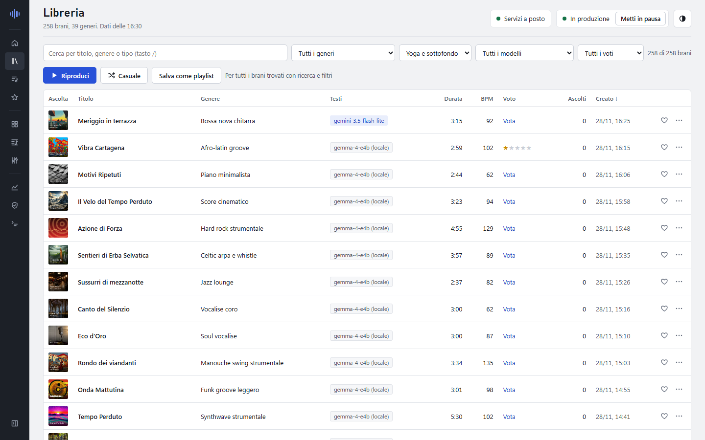

- **Copertina con ▶**: ascolta il brano. **Titolo**: apre la scheda.
- **Suggerimenti**: lasciando il mouse su molti elementi compare una spiegazione.
- **Conferme**: dopo ogni modifica appare un messaggio in basso. Le azioni che tolgono qualcosa chiedono prima conferma.
- **Avviso rosso in cima**: la pagina non riesce a collegarsi. I numeri a video sono vecchi; riprova da sola.
- Ogni pagina ha il suo indirizzo: puoi salvarla tra i **preferiti**.

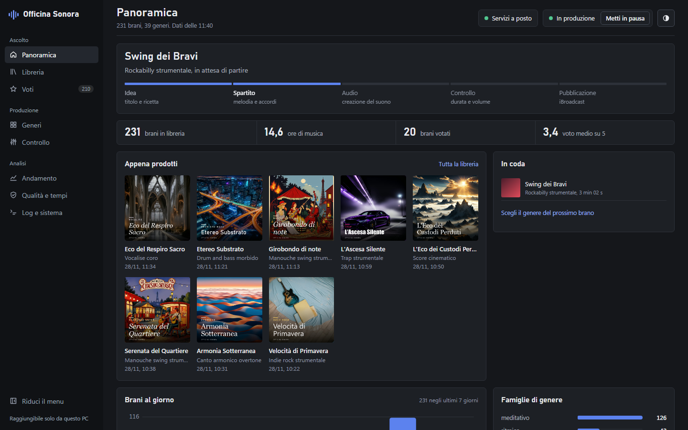

### Il lettore

Premendo su una copertina si apre il **lettore** in basso, che continua a suonare mentre navighi. Gli altri brani
dell'elenco da cui sei partito vengono dopo, in quell'ordine (in Libreria: **tutti** quelli trovati con i filtri, non
solo i 50 a video).

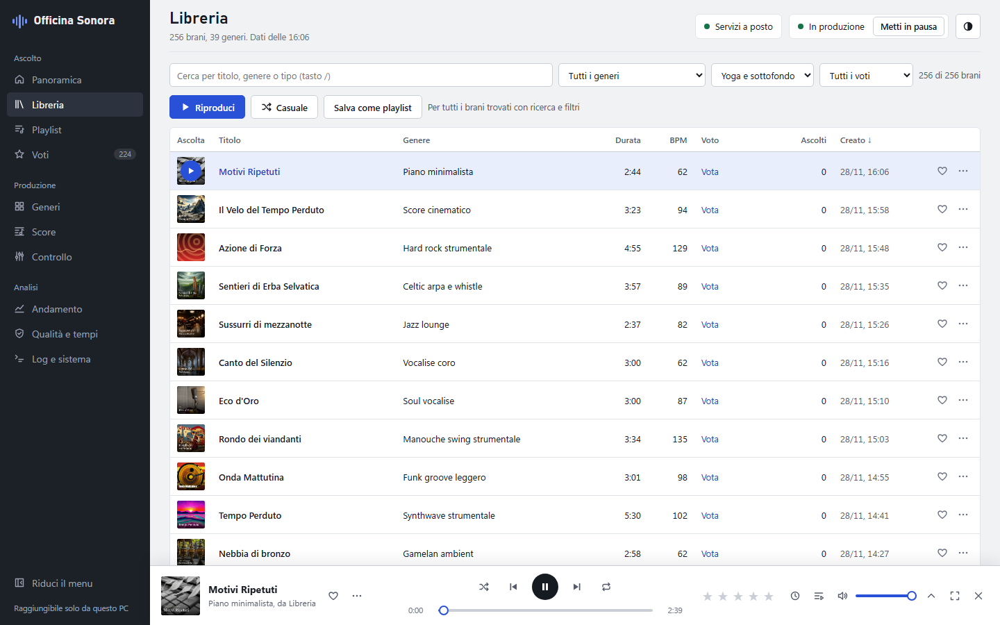

| Nel lettore | Cosa fa |
|---|---|
| ♡ | **Mi piace**: mette il brano in *Brani che ti piacciono* |
| ⋯ | il [menu del brano](#il-menu-di-un-brano) |
| casuale | mescola i brani che restano; spento, torna l'ordine dell'elenco dal brano in corso |
| ⏮ ⏭ | precedente e successivo. A brano avviato da più di 3 secondi, ⏮ lo ricomincia |
| ripeti | un clic ripete **tutto l'elenco**, due ripetono **questo brano** (compare un 1), tre spengono |
| barra e tempi | trascina per spostarti; clic sul tempo a destra per vedere quanto **resta** |
| stelle | vota il brano in ascolto (è il voto da cui il sistema impara) |
| orologio | [timer, dissolvenza e scorciatoie](#timer-dissolvenza-e-scorciatoie) |
| coda | apre la [coda di ascolto](#coda-e-cronologia) |
| volume | altoparlante per silenziare; la rotellina del mouse sul cursore lo regola |
| ⌃ e riquadro | **lettore grande** e **schermo intero** |
| ✕ | chiude il lettore e ferma l'ascolto |

**Cuore e stelle sono due cose diverse:** il cuore serve a *ritrovare* un brano, le stelle a *insegnare* al sistema
i tuoi gusti.

Ricaricando la pagina (o riaprendola) ritrovi brano, punto di ascolto, coda e impostazioni: il lettore riparte **in
pausa**. Funzionano anche i **tasti multimediali** della tastiera e i controlli di Windows, con titolo e copertina.
Se un file non si apre, il lettore passa al successivo.

#### Coda e cronologia

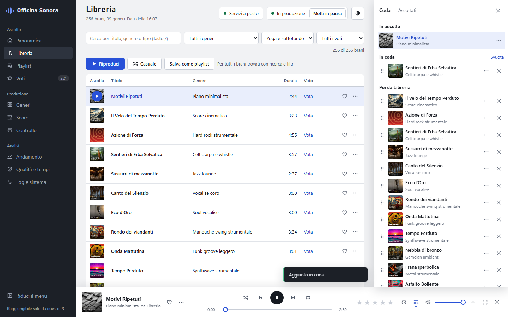

| Nel pannello | Significato |
|---|---|
| **In ascolto** | il brano di adesso |
| **In coda** | i brani che hai aggiunto tu: passano **davanti** a tutto. *Svuota* li toglie |
| **Poi da…** | il seguito dell'elenco da cui sei partito |
| clic sul titolo | salta subito a quel brano |
| maniglia a puntini | trascina per riordinare; da tastiera, mettila a fuoco e usa **↑ ↓** |
| ✕ | toglie il brano dalla coda |
| *Salva come playlist* | conserva il brano in corso e quelli in arrivo |
| scheda **Ascoltati** | gli ultimi 100 brani ascoltati in questo browser, con la possibilità di cancellarli |

#### Lettore grande

Il pulsante ⌃ allarga il lettore a tutta la pagina: copertina, comandi e coda, con il colore del genere sullo sfondo.
Il pulsante **Schermo intero** nasconde anche il browser: utile durante una lezione. **Esc** torna indietro.

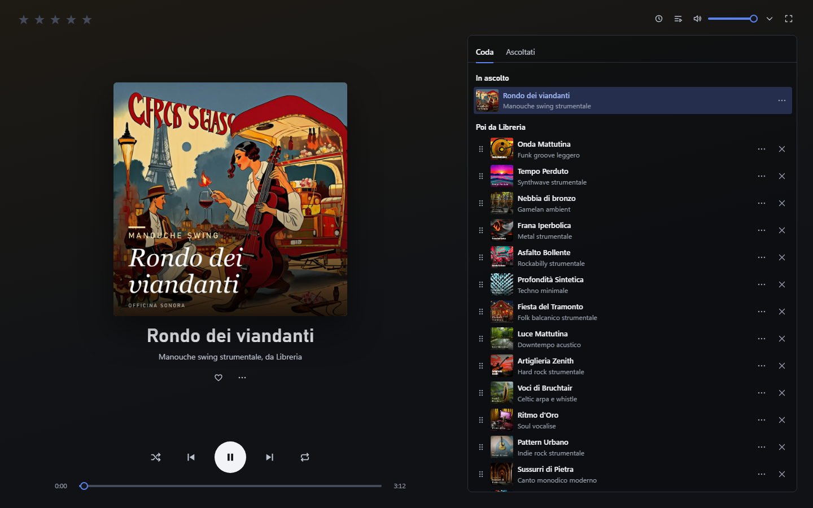

#### Timer, dissolvenza e scorciatoie

<p align="center">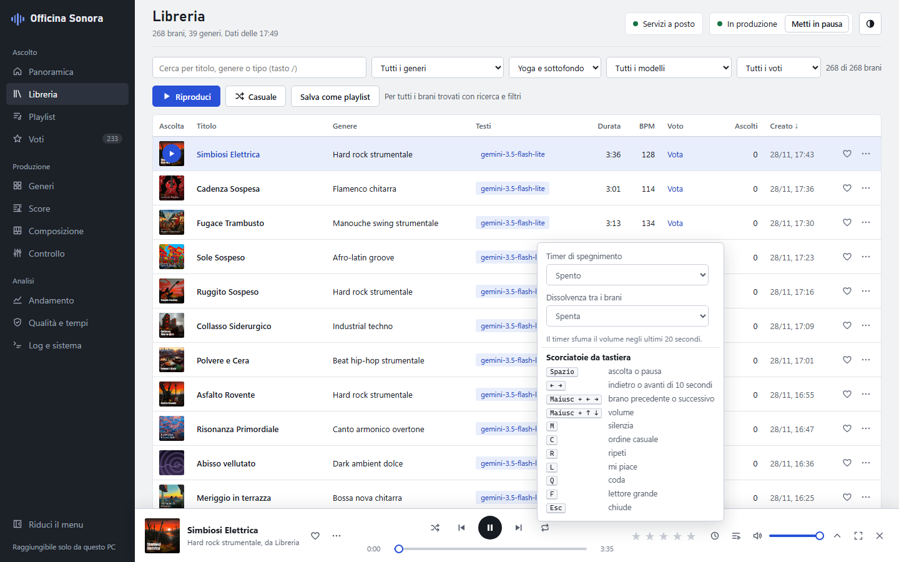</p>

- **Timer di spegnimento**: da 5 a 90 minuti, oppure *alla fine del brano*. Negli ultimi 20 secondi il volume sfuma,
  poi l'ascolto si ferma. Il tempo che resta è scritto accanto all'orologio.
- **Dissolvenza tra i brani**: 3, 6, 10 o 15 secondi in cui un brano esce mentre il successivo entra, senza silenzi.
  Vale al passaggio automatico, non quando salti a mano.

| Tasto | Cosa fa |
|---|---|
| **Spazio** | ascolta o pausa |
| **← →** | indietro o avanti di 10 secondi |
| **Maiusc + ← →** | brano precedente o successivo |
| **Maiusc + ↑ ↓** | volume |
| **M** · **C** · **R** | silenzia, casuale, ripeti |
| **L** · **Q** · **F** | mi piace, coda, lettore grande |
| **Esc** | chiude lettore grande o coda |

Le scorciatoie valgono a lettore aperto; nella pagina *Voti* contano i suoi tasti.

#### Il menu di un brano

Si apre con **⋯** o con il **tasto destro** su un brano: *Riproduci ora*, *Riproduci dopo*, *Aggiungi in coda*, cuore,
aggiunta a una playlist (anche nuova), scheda, voto, *Produci un altro di questo genere* e scarico del file. Nelle
tabelle, un **doppio clic** sulla riga fa partire il brano.

<p align="center">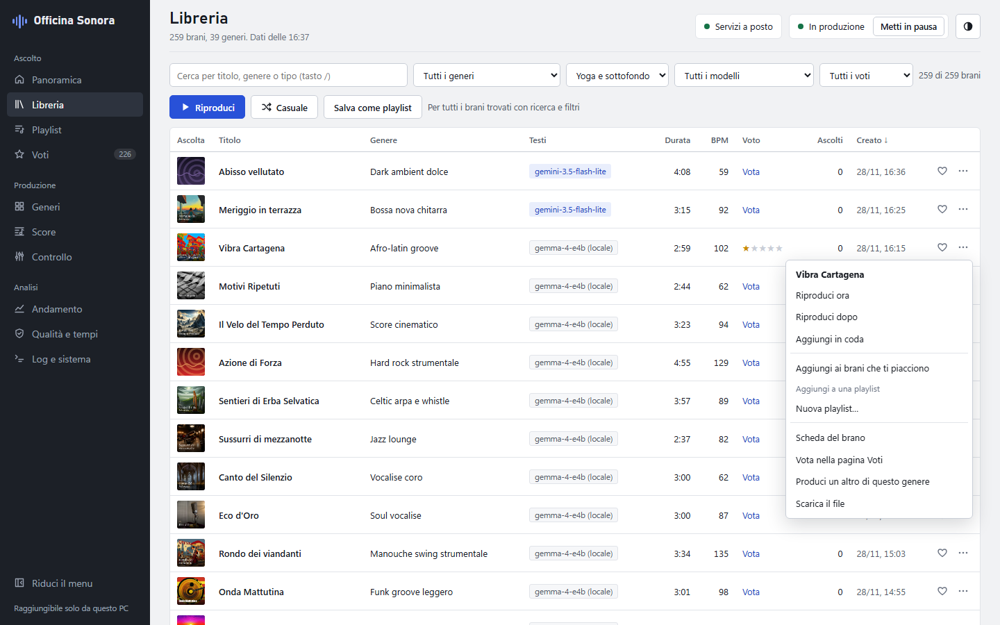</p>

### La scheda del brano

La **scheda** (clic sul titolo) raccoglie tutto sul brano: descrizione, durata, bpm, tonalità, strumenti, sezioni,
descrizione inviata al motore (*Copia*), esito del controllo, file. Da lì puoi ascoltare, mettere il cuore, aggiungerlo
a coda o playlist, votare, **scaricare il file**, chiedere **un altro così** o aprire lo stile del genere.

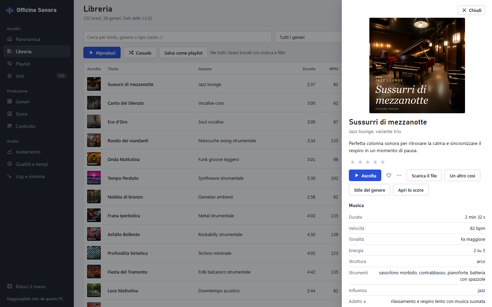

---

### Panoramica


| Parte | Cosa ti dice |
|---|---|
| **Fasi del brano** | a che punto è quello in lavorazione: idea, spartito, audio, controllo, pubblicazione. La barra dell'audio è una stima sul tempo medio |
| **Avvisi** (compaiono solo se servono) | programmi fermi, produzione in pausa, disco quasi pieno, caricamenti in attesa, brani abbandonati, voti che mancano da giorni. Ognuno ha il suo pulsante |
| Quattro numeri | brani, ore, votati, voto medio (clic per aprire la pagina collegata) |
| **Appena prodotti** | gli ultimi otto brani, da ascoltare con un clic |
| **In coda** | i prossimi brani e l'eventuale genere richiesto |
| **Brani al giorno** e **Famiglie** | quanta musica e di che tipo |

---

### Libreria

L'archivio di **tutta la musica prodotta** (i brani scartati non ci sono).

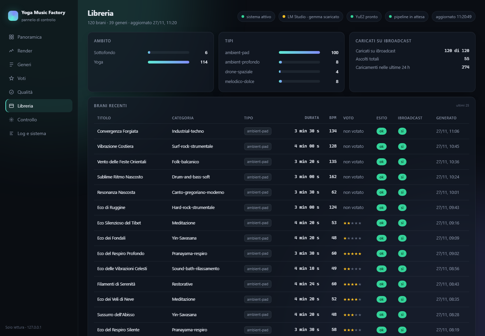

| Per… | Fai così |
|---|---|
| trovare un brano | tasto **/** oppure la casella di ricerca (titolo, genere, tipo) |
| filtrare | per genere, ambito (yoga o sottofondo), voto o *Che ti piacciono* |
| ascoltare tutto ciò che hai filtrato | *Riproduci* o *Casuale* sopra la tabella; *Salva come playlist* lo conserva |
| cuore, coda, playlist | cuore e **⋯** in fondo a ogni riga |
| mettere in ordine | clic sul titolo di una colonna; un altro clic inverte |
| ascoltare | clic sulla copertina |
| aprire la scheda | clic sul titolo |
| votare | clic su *Vota* (o sulle stelle) nella colonna *Voto* |
| vedere altri brani | *Mostra altri 50* in fondo |

---

### Playlist

Le raccolte da ascoltare. Clic su una copertina per aprirla, sul ▶ per farla partire.

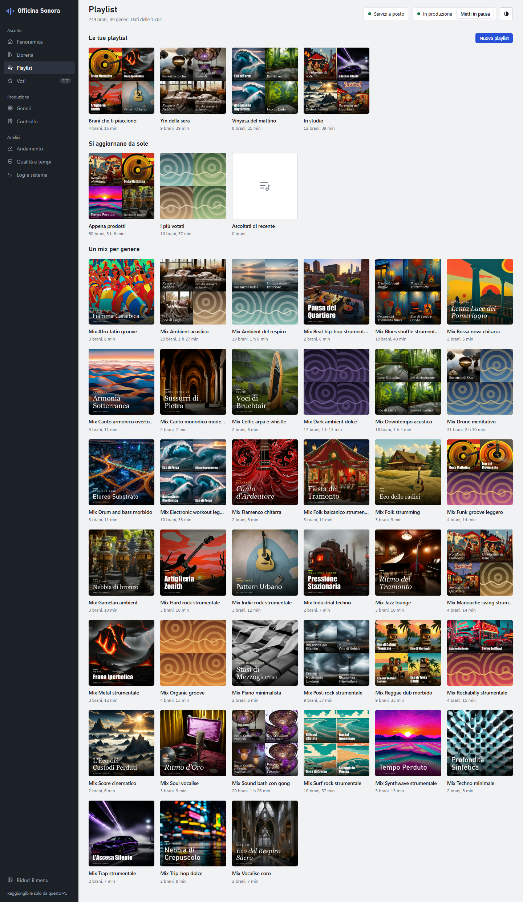

| Raccolta | Come si riempie |
|---|---|
| **Le tue playlist** | le crei tu (*Nuova playlist*, o dal menu **⋯** di un brano) |
| **Brani che ti piacciono** | con il cuore |
| **Appena prodotti** · **I più votati** · **Ascoltati di recente** | da sole: gli ultimi 50, quelli con 4 o 5 stelle, la cronologia di questo browser |
| **Un mix per genere** | da sole: tutti i brani di un genere |

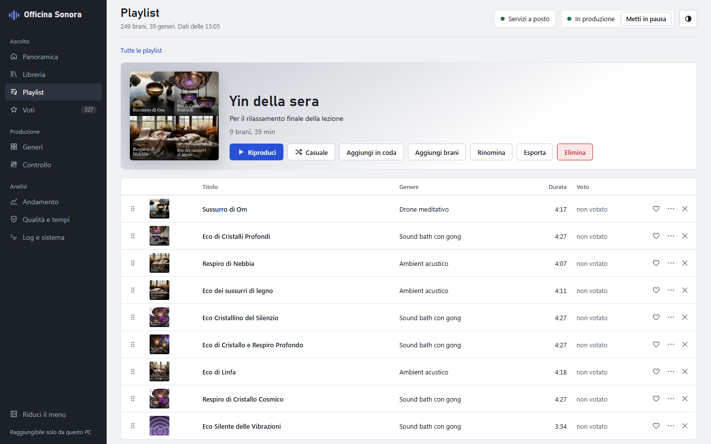

| In una playlist | Cosa fa |
|---|---|
| *Riproduci* · *Casuale* · *Aggiungi in coda* | ascolto |
| *Aggiungi brani* | cerca nella libreria e aggiunge o toglie con un clic |
| maniglia a puntini | trascina per cambiare l'ordine; da tastiera **↑ ↓** |
| ✕ sulla riga | toglie il brano dalla playlist (resta in libreria) |
| *Rinomina* · *Elimina* | nome e descrizione; l'eliminazione chiede conferma |
| *Esporta* | file `.m3u8` con i percorsi dei brani, per VLC e altri lettori di questo PC |
| *Salva come playlist* (raccolte automatiche) | ne fa una copia che puoi modificare |

Playlist e preferiti stanno in `state\playlist.json`, su questo computer: **non** vengono inviati a iBroadcast e non
sono nel repository (mettilo nelle tue copie di sicurezza). Un brano scartato o cancellato sparisce dalle raccolte.

---

### Voti

Il sistema **impara dai tuoi voti**: i generi e le scelte che ti piacciono tornano più spesso. Il numero accanto
a *Voti* nel menu dice quanti brani aspettano.


1. Premi ▶ per **ascoltare** il brano proposto.
2. Se vuoi, scrivi una **nota** (per esempio *troppo lento*).
3. Premi da **una a cinque stelle**: si passa subito al brano successivo.

| Tasto della tastiera | Azione |
|---|---|
| **1 – 5** | dà il voto |
| **Spazio** | ascolta o mette in pausa |
| **S** | salta il brano |

In **Votati di recente** un clic corregge il voto. Sotto: quante volte hai dato ogni voto, il voto medio per
genere, i brani più apprezzati e quelli da rivedere.

---

### Generi

Un **genere** è un tipo di musica (per esempio *Drone meditativo* o *Blues shuffle strumentale*): ce ne sono 39.


| Nella scheda | Cosa fa |
|---|---|
| **Interruttore** | acceso = il genere viene prodotto, spento = sospeso |
| **Produci ora** | il prossimo brano sarà di quel genere (una volta sola) |
| **Modifica stile** | apre le [linee guida](#linee-guida) del genere |
| **Ascolta i brani** | apre la libreria filtrata su quel genere |
| **Specifiche complete** | strumenti, forme, tonalità e statistiche |

#### Pesi dei generi

La vista **Attivazione e frequenza** serve per lavorare su molti generi insieme.

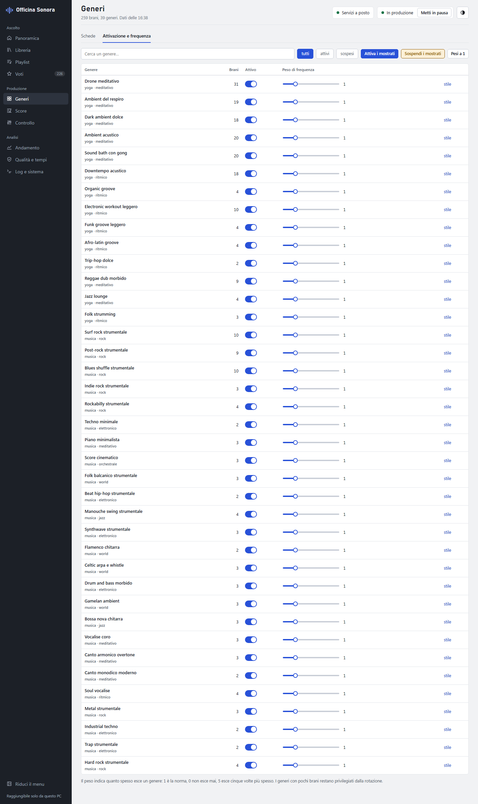

- **Peso**: 1 è normale, 0 non esce mai, 5 esce cinque volte più spesso.
- Ricerca, *tutti / attivi / sospesi*, **Attiva i mostrati**, **Sospendi i mostrati** (scrivi *rock* e sospendili
  insieme) e **Pesi a 1**.

---

### Controllo

Qui **cambi il comportamento** del sistema. Le modifiche valgono **dal brano successivo** e si ritrovano nello
[Storico](#storico).

| Sezione | In parole semplici |
|---|---|
| [Produzione](#produzione) | pausa, coda, sfondi delle copertine, genere da produrre |
| [Linee guida](#linee-guida) | come deve suonare la musica |
| [Note per genere](#note-per-genere) | richieste scritte in italiano |
| [Parametri](#parametri) | regole generali, con dei cursori |
| [Messaggi](#messaggi) | cosa ricevere su Telegram |
| [Storico](#storico) | cosa è stato cambiato e quando |

#### Produzione


- **Metti in pausa / Riprendi**: il brano in corso finisce, poi il sistema aspetta.
- **Coda**: elenco dei brani in attesa e *Svuota la coda*.
- **Sfondi delle copertine**: crea le immagini; mette in pausa la produzione e poi la riprende.
- **Produci ora un genere**: scegli dall'elenco e conferma.

#### Parametri


Ogni riga spiega a cosa serve. Sposta il cursore (o scrivi il numero): **Salva** si accende solo se il valore è
cambiato; **Predefinito** torna al valore iniziale. Se non sai cosa fa un valore, lascialo com'è.

#### Linee guida

Il motore che crea la musica riceve una **descrizione in inglese** fatta di tanti termini (*warm bass*, *slow swells*…).
Qui scegli quei termini senza doverli scrivere. Ci sono tre sottosezioni.

##### Stile di tutti i generi


Quello che metti qui vale per **ogni** brano.

##### Stile di un genere

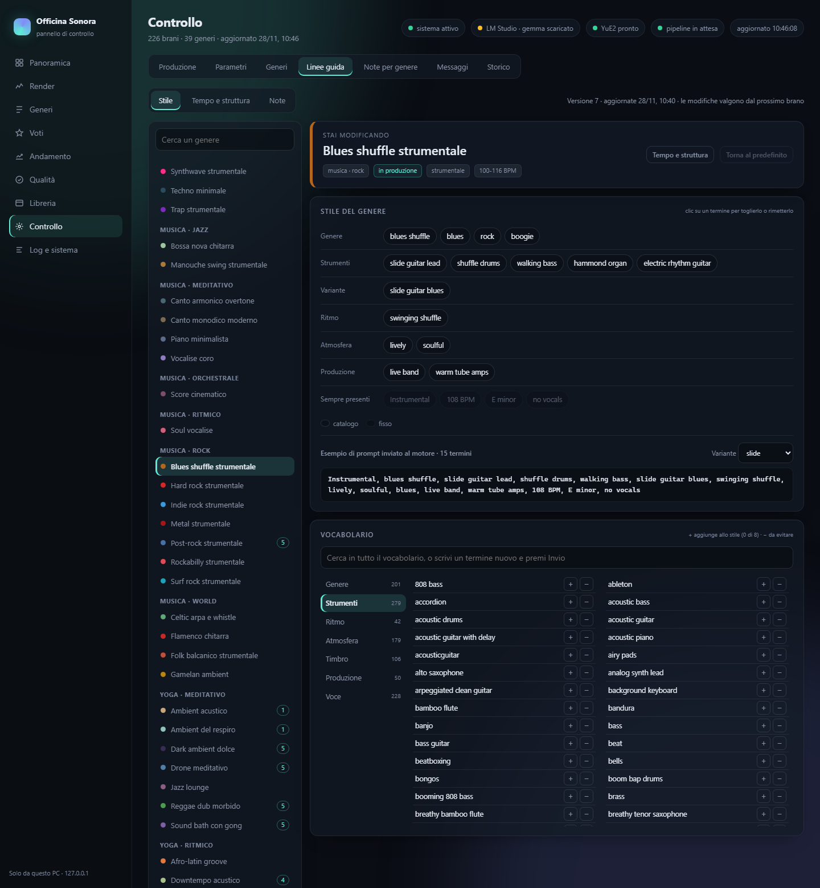

1. **Scegli il genere** nell'elenco a sinistra (il numero indica quante modifiche ha). In alto leggi sempre quale
   stai modificando.
2. **Stile del genere**: i termini sono divisi per argomento. Un clic ne **toglie** uno; un altro clic lo rimette.
3. **Esempio di prompt**: è il testo che riceve il motore.
4. **Vocabolario**: **+** aggiunge un termine (massimo 8), **−** lo mette tra quelli *da evitare*. Un secondo clic
   annulla. Se un termine manca, scrivilo nella ricerca e premi Invio.
5. **Torna al predefinito** cancella le tue scelte.

Lasciando il mouse su un termine leggi **cosa significa** e cosa succede se lo applichi:

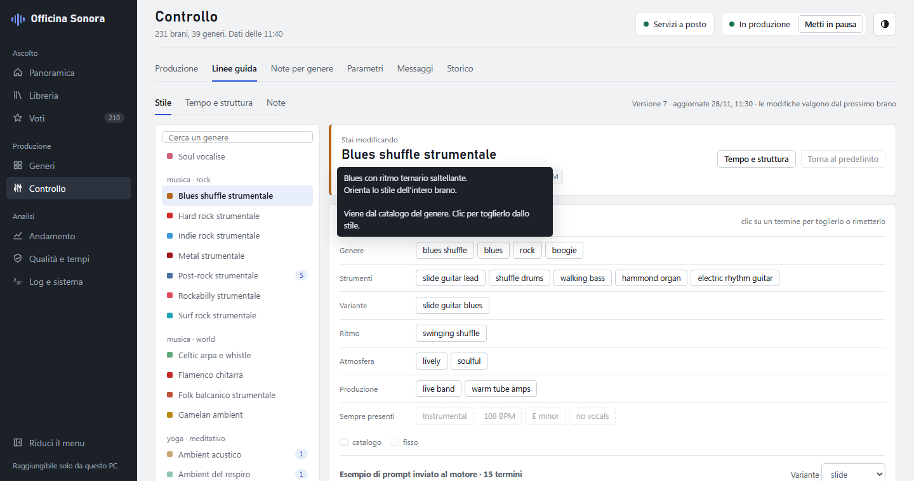

> Le spiegazioni descrivono il significato musicale dei termini: sono indicative, l'effetto sul motore non è stato
> misurato. «Da evitare» **toglie** il termine dalla descrizione: il motore non riceve un divieto.

##### Tempo e struttura

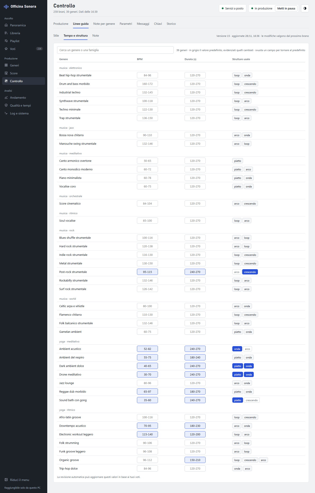

Per ogni genere: **BPM** (velocità), **durata** in secondi e **strutture** (la forma del brano). In grigio il valore
predefinito, evidenziato quello cambiato. Per tornare al predefinito svuota il campo.

| Struttura | Come suona |
|---|---|
| piatto | energia costante |
| onda | sale e scende |
| arco | cresce fino al centro, poi si distende |
| crescendo | cresce fino al finale |
| loop | parti che ritornano |

##### Note per il sistema

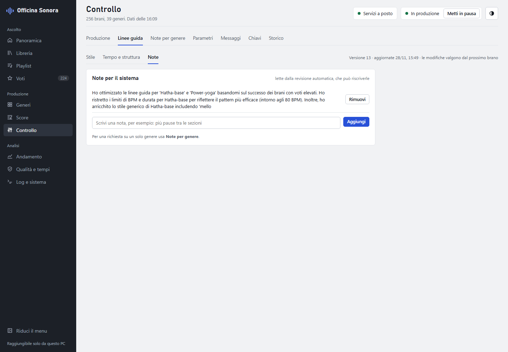

Indicazioni generali, lette dalla **revisione automatica** (il controllo che il sistema fa ogni pochi brani sui tuoi
voti). La revisione può modificare linee guida, tempi e note.

Regole controllate dalla pagina: termini di 2-60 caratteri, senza virgole, negazioni, BPM o tonalità; niente voci nei
generi strumentali. Il vocabolario è in `config\vocabolario.json` (termini del catalogo e tag del primo
[YuE](https://github.com/multimodal-art-projection/YuE), Apache-2.0, in `config\yue-v1`); le spiegazioni in
`config\spiegazioni`.

#### Note per genere


Il modo più semplice per chiedere un cambiamento: scegli il genere e scrivi in italiano, per esempio *più assoli di
chitarra*. La richiesta viene tradotta in inglese e aggiunta allo stile.

#### Messaggi

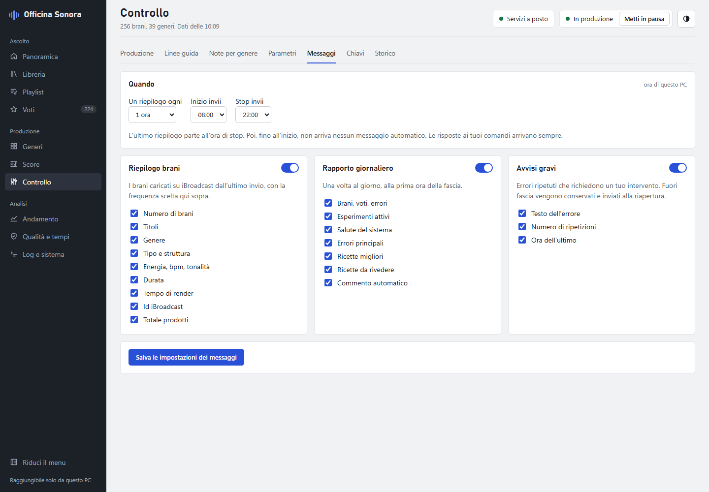

Scegli ogni quanto ricevere il riepilogo su Telegram, in quali ore e con quali informazioni, poi premi **Salva**.

#### Storico

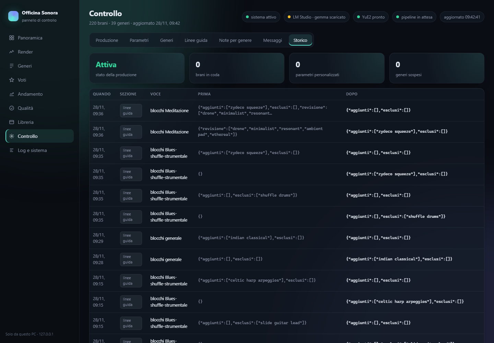

Il diario delle modifiche fatte dalla dashboard: quando, cosa, **prima** e **dopo** (le ultime 300). Si filtra per
sezione e si cerca. Per annullare, rimetti il valore precedente nella sezione corrispondente.

---

### Andamento

Risponde alla domanda **«sta migliorando?»**.

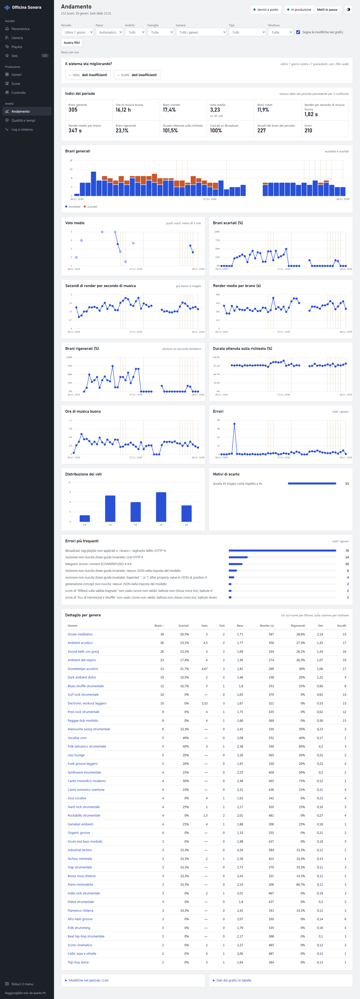

| Parte (dall'alto) | Cosa mostra |
|---|---|
| **Filtri** | scegli il periodo (da 24 ore a tutto) e, se vuoi, ambito, famiglia, genere, tipo o struttura; *Azzera filtri* torna agli ultimi 7 giorni |
| **Il sistema sta migliorando?** | giudizio sugli ultimi 7 giorni rispetto ai 7 precedenti |
| **Indici del periodo** | brani, ore di musica buona, scarti, voto medio e altri numeri, con la differenza sul periodo precedente |
| **Grafici** | come cambiano nel tempo; le righe verticali tratteggiate sono le modifiche fatte da te o dalle linee guida |
| **Distribuzione, motivi, errori** | voti, ragioni degli scarti ed errori più frequenti |
| **Dettaglio per genere** | tabella ordinabile; clic sul nome per vedere solo quel genere |
| In fondo | elenco delle modifiche e dati dei grafici in forma di tabella |

| Giudizio su | Brani necessari per periodo | Cambiamento minimo per dire «migliora» o «peggiora» |
|---|---|---|
| Voto medio | 10 votati | 0,2 stelle |
| Brani scartati | 30 | 5 punti percentuali |

Con meno dati compare *dati insufficienti*; con differenze più piccole, *stabile*.

---

### Qualità e tempi

Ogni brano viene controllato: quelli difettosi (di solito **troppo corti**) vengono **scartati** e non pubblicati.


- **Brani scartati**: quanti su cento non superano il controllo, con i motivi (la lettera **N** sta al posto di un
  numero) e i generi più colpiti.
- **Errori nelle ultime 24 ore**: alcuni sono normali, il sistema riprova da solo.
- **Tempi**: quanto ci mette il computer a creare un brano, confrontato con la durata richiesta; velocità e tipi.

---

### Log e sistema

La pagina «tecnica»: utile quando qualcosa non va.

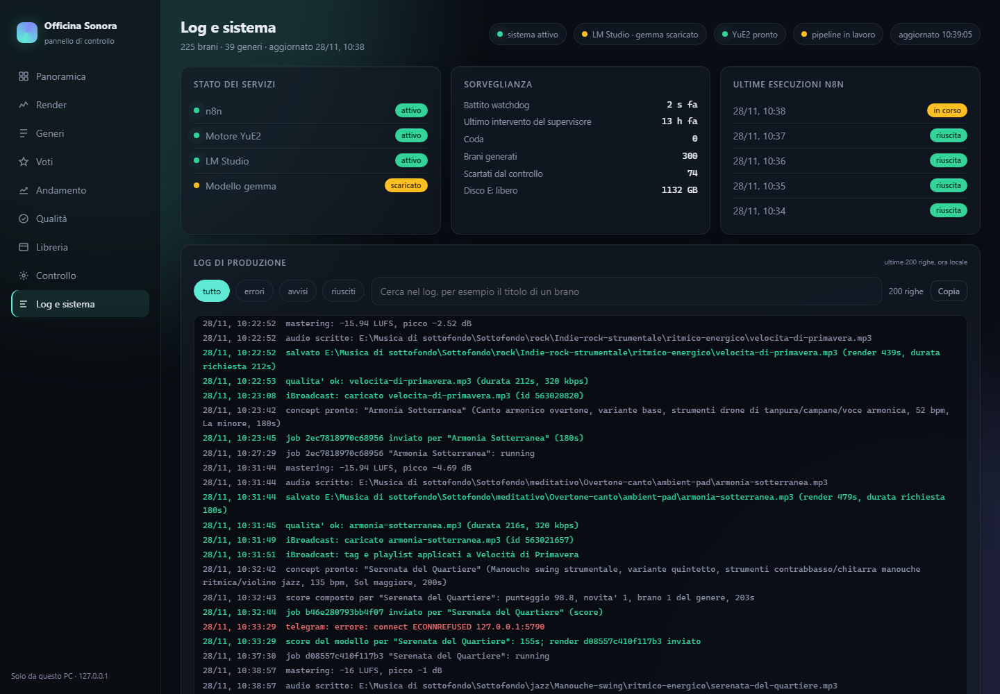

- **Stato dei servizi** e **sorveglianza**: il *battito del watchdog* (il guardiano che riavvia i programmi) deve
  essere di pochi secondi. *Ultimo intervento del supervisore* indica l'ultima volta che è servito un riavvio:
  **un valore alto è un buon segno**.
- **Log di produzione**: il diario, in ora locale. Filtra *errori*, *avvisi* o *riusciti*, cerca il titolo di un brano,
  **Copia** per incollarlo altrove. Se scorri verso l'alto resta fermo; torna in fondo per seguire le righe nuove.

---

### Dal telefono

Su uno schermo stretto il menu passa in alto e scorre di lato; le pagine si leggono in una sola colonna. La dashboard
resta comunque raggiungibile **solo dal computer che la ospita**: dal telefono vero si usa [Telegram](#6-telegram).

<p align="center">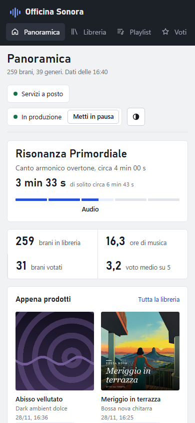</p>

---

## 6. Telegram

Il bot manda il **riepilogo** dei brani (predefinito: ogni ora dalle 8 alle 22; quelli della notte arrivano
alle 8), il **rapporto giornaliero** e gli **avvisi** per errori ripetuti. Fuori fascia i messaggi automatici
aspettano; le risposte ai tuoi comandi arrivano sempre.

| Comando | Cosa fa |
|---|---|
| `/menu` | menu a pulsanti, compreso **Vota un brano** |
| `/stato` | produzione attiva o in pausa, brani, coda, generi attivi |
| `/pausa` · `/riprendi` | ferma la produzione dopo il brano in corso, o la riavvia (anche dai pulsanti del menu) |
| `/annulla` | scarta le modifiche in attesa |
| `/aiuto` | elenco dei comandi |

Puoi anche scrivere in italiano cosa cambiare (*"Vinyasa più ritmato, bpm tra 100 e 120"*): il bot riassume
la modifica e la applica solo dopo il tuo **Conferma**.

---

## 7. Votare i brani

Voti da 1 a 5, salvati nella scheda `.json` del brano, che è l'unica fonte.

- **Dashboard** (scheda *Voti*): un brano alla volta, stelle o tasti **1-5**, nota facoltativa (massimo
  300 caratteri, senza `<` o `>`), *Salta*, filtro per genere, *Votati di recente* per correggere. La coda esclude
  scartati e brani generati da meno di 15 minuti.
- **Telegram**: `/menu` → *Vota un brano* (gli 8 più recenti), voto e nota.
- **iBroadcast**: stelle; tag o playlist `preferito`, `scarta`, `voto-N`; cestino (vale 1). Le stelle prevalgono
  sui tag, e i tag sul cestino. I tag `piu-veloce` / `piu-lento` spostano il bpm del genere di 6 (entro 15 dalla base).
  I tag e le playlist creati dal sistema non contano.

**Vince l'ultimo.** Un segnale di iBroadcast sostituisce il voto solo quando **cambia** (lettura ogni 10 minuti);
se lo togli, il voto resta. I voti dati da dashboard e Telegram non vengono scritti su iBroadcast.

---

## 8. iBroadcast, copertine e metadati

Ogni brano su [ibroadcast.com](https://ibroadcast.com) ha titolo, copertina, numero di traccia unico, album
(il nome del genere; i brani più vecchi hanno il nome della categoria), tag (ambito, famiglia, categoria,
energia, struttura, tipo) e playlist `Yoga - <categoria>` o `Musica - <categoria>`.

Gli MP3 hanno tag ID3 completi (anche bpm, tonalità, mood, strumenti, variante e seed come campi aggiuntivi).

La **copertina** è uno sfondo del genere generato con Stable Diffusion, con titolo, genere e artista:

1. *Controllo → Produzione*: **Metti in pausa e genera gli sfondi** (8 per genere; si può interrompere e riprendere).
   Per rifarne uno cancella il file in `assets\sfondi\<categoria>` (`_foglio.jpg` li mostra tutti).
2. Il prompt di ogni genere è nel campo `copertina` del catalogo.
3. Per aggiornare i brani già online: prima `node tools\ripubblica.js --prova <a.json> <b.json> <c.json>`
   (almeno uno con le stelle), controlla nell'app, poi `node tools\ripubblica.js --tutti`. La vecchia copia si
   cestina solo dopo che la nuova ha tag, playlist e voti; il conteggio degli ascolti riparte da zero.

---

## 9. Generi e libreria

Tre livelli: **ambito** (`Yoga` o `Sottofondo`), **famiglia** (meditativo, ritmico, rock, elettronico,
orchestrale, world, jazz) e **categoria** (il genere preciso). Il catalogo ha **39 generi**.

```
E:\Musica di sottofondo\
  Yoga\<famiglia>\<categoria>\<tipo>\        brano.mp3 + brano.json + brano.abc
  Sottofondo\<famiglia>\<categoria>\<tipo>\  brano.mp3 + brano.json + brano.abc
  _scartati\                                 brani non superati dal controllo qualità
```

I brani prodotti prima del salvataggio dello score non hanno il file `.abc`.

**Aggiungere un genere:** in `config\catalogo.json` aggiungi il campo `en` (descrittori inglesi per ogni strumento), `name`, `ambito`, `famiglia`, `energia` (1-5),
`bpm`, `attivita`, `strutture`, `genere`, `stile`, `strumenti`, `vietati`, `influenze`, `enfasi`, `melodia`,
`accordi`, `ritmica`, `tonalita`, `varianti`, `colori`; facoltativi `lora`, `copertina` e
`vocale_senza_parole`. Poi ricostruisci e pubblica il workflow.

---

## 10. Requisiti e installazione

Windows 11 con GPU NVIDIA (qui una RTX 3060 Laptop da 6 GB).

| Componente | Dove | Note |
|---|---|---|
| n8n 2.x | `E:\n8n` | installato con npm |
| Node.js 24 | nel PATH | gateway e test |
| YuE2 Studio | `E:\MusicAI\YuE2 Studio` | motore yue2.cpp sulla porta 18087 (CUDA), LoRA in `data\adapters` |
| ffmpeg | `E:\MusicAI\ffmpeg` | mastering |
| LM Studio | porta 1234 | modello `google/gemma-4-e4b` |
| Account iBroadcast e bot Telegram | | token cifrati in `secrets\` |

Non sono nel repository: n8n, i file `avvia-automazione.vbs` e `ferma-automazione.vbs` (in `E:\n8n`), motore e
modelli, libreria audio, `secrets\`, `state\`, gli sfondi e `config\telegram.json`.

---

## 11. Sicurezza

- Token Telegram e iBroadcast cifrati con **DPAPI**: leggibili solo dal tuo utente su questo PC.
- Solo il **gateway** li conosce; i blocchi n8n lo chiamano su `127.0.0.1`.
- Se `config\parametri.json` o le linee guida risultano illeggibili, la dashboard rifiuta di salvare invece di
  sovrascriverli.
- Il gateway accetta solo richieste dal tuo PC (`127.0.0.1:5790` o `localhost:5790`) e rifiuta le scritture
  inviate da pagine di altri siti. La dashboard non mostra token; l'audio si chiede per numero, mai per percorso.
- Per rinnovare l'accesso a iBroadcast: `ibroadcast-login.ps1`. Per Telegram: aggiorna `secrets\telegram.dpapi`.
- `config\telegram.json` va creato a mano: `{ "chat_id": 000000000 }` con il tuo identificativo.

---

## 12. Risoluzione dei problemi

| Sintomo | Cosa fare |
|---|---|
| La dashboard non si apre | l'automazione è ferma: `avvia-automazione.vbs`. Se il gateway si è chiuso per un errore, vedi `state\gateway-errori.log` |
| Playlist o cuori non si salvano | il messaggio dice il motivo; se `state\playlist.json` è illeggibile il gateway non lo sovrascrive: correggilo o rinominalo |
| L'automazione non riparte da sola | l'hai fermata tu: il file `state\STOP` resta finché non lanci `avvia-automazione.vbs` |
| Nessun brano da molto | controlla i servizi in dashboard e che la produzione non sia in pausa |
| Il motore non risponde | il watchdog lo riavvia; vedi `state\watchdog.log` |
| "riaccodo ... failed" nel log | il motore non ha completato il render: il ripiego è automatico |
| "score del modello non riuscito" | il brano passa al ripiego da solo; se è frequente per un genere, controlla il suo campo `en` |
| "mastering fallito" | verifica ffmpeg e riavvia il gateway; dopo 5 tentativi il motore consegna l'MP3 |
| Molti brani "troppo corti" | limite noto (vedi miglioramenti); le soglie sono in *Controllo → Parametri* |
| Voci in un brano strumentale | vota 1 con una nota; la LoRA in uso è registrata nella scheda |
| "revisione non riuscita: LLM HTTP 400" | gemma non era caricato: le linee guida restano invariate |
| "risposta del modello troncata (max_tokens)" | il ragionamento di gemma ha esaurito il margine (`RAGIONAMENTO_TOKEN` in `src/lib.js`) |
| "token non valido" | rinnova il token (vedi Sicurezza) |
| Un brano manca su iBroadcast | si ritenta da solo ogni ora; se resta in attesa la Panoramica lo segnala: cerca il motivo in `state\tick.log` |

Log: `state\tick.log` (produzione), `state\watchdog.log` (servizi), `state\supervisore.log` (supervisore),
`state\errori.jsonl` (errori).

---

## 13. Per chi sviluppa

| Cartella / file | Contenuto |
|---|---|
| `src\blocks\` | i blocchi del workflow |
| `src\lib*.js`, `src\cover.js` | funzioni condivise |
| `src\compositore\` | compositore, revisore, scrittura e validazione dello score ABC |
| `config\` | catalogo, vocabolario di stile, linee guida e storico, parametri |
| `gateway\` | servizio locale e dashboard (`dashboard.html`, `.css`, `.js`; `libreria.js` indice delle schede, `id3.js` copertine, `disco.js` scrittura atomica; `lettore.js` e `.css` lettore e playlist, `coda.js` logica della coda, `playlist.js` salvataggio) |
| `tools\` | manutenzione, prove sul motore (`prove\`), test (`test\`) |
| `docs\superpowers\` | documenti di progetto e piani |
| `officina-sonora-workflow.json` | workflow generato |

```powershell
node --test tools/test/*.test.js
```

Il test `rotazione` si basa sul caso (su una libreria finta) e di rado può andare ripetuto.

**Pubblicare una modifica** (da `E:\n8n\officina-sonora`, poi da `E:\n8n` con `N8N_USER_FOLDER=E:\n8n\data`):

```powershell
node build-workflow.mjs
```
```powershell
.\node_modules\.bin\n8n.cmd import:workflow --input=E:/n8n/officina-sonora/officina-sonora-workflow.json
```
```powershell
.\node_modules\.bin\n8n.cmd publish:workflow --id=yogaMusicFactory01
```

n8n in esecuzione applica la nuova versione da sé; il render in corso continua. L'identificativo del workflow
è rimasto quello originario. Se cambi file in `gateway\`, riavvia anche il gateway.

**Screenshot e diagramma:** `tools\screenshot.ps1` (gateway attivo; usa `tools\screenshot.mjs`, che fotografa le
pagine per intero) e `node tools\diagramma.mjs`. Per immagini con playlist di esempio senza toccare le tue, avvia un
secondo gateway con `OFS_PORTA` e `OFS_PLAYLIST` impostate e lancia gli screenshot con la stessa `OFS_PORTA`.
`tools\pubblica.ps1 -Messaggio "..."` li rigenera, committa e invia su GitHub.

**Prove sul motore:** `node tools/prove/prove-motore.js` confronta score, lyrics e LoRA e crea una pagina di
ascolto in `state\prove\`. Occupa la GPU: va eseguito solo a produzione ferma.

**Regola di progetto:** ogni modifica importante aggiorna questo README (vedi `CLAUDE.md`).

---

## 14. Miglioramenti futuri

In ordine di priorità. Il disegno completo è in
[`docs/superpowers/specs`](docs/superpowers/specs/2026-11-27-processo-artistico-design.md).

| # | Miglioramento | Perché |
|---|---|---|
| 1 | **Selezione sull'audio**: 2-3 versioni per brano e pubblicazione della migliore, giudicata da un modello (per esempio Meta Audiobox Aesthetics o SongEval) | richiede di scaricare pacchetto e pesi, e di verificarli sugli strumentali |
| 2 | **Ascoltare e votare** i brani del nuovo percorso, poi correggere i descrittori `en` e le soglie dello score | la qualità musicale non è verificabile dai test |
| 3 | **Rivalutare le LoRA** (KTO, strumentale cot-full, slider di genere) sul backbone attuale | le scale attuali non sono validate a orecchio |
| 4 | **Dashboard**: mostrare lo score ABC nella scheda del brano | oggi si vedono chi l'ha scritto e le sezioni, non le note |
| 5 | **Lettore**: equalizzatore, playlist inviate a iBroadcast, cronologia comune a più browser | oggi restano su questo PC e nel browser |
| 6 | **Schede artistiche** più ricche per i generi attivi: forme e varianti vere al posto di quelle segnaposto | generi più distinti |
| 7 | **Agente di ricerca locale**, con approvazione in dashboard | miglioramento artistico continuo |
